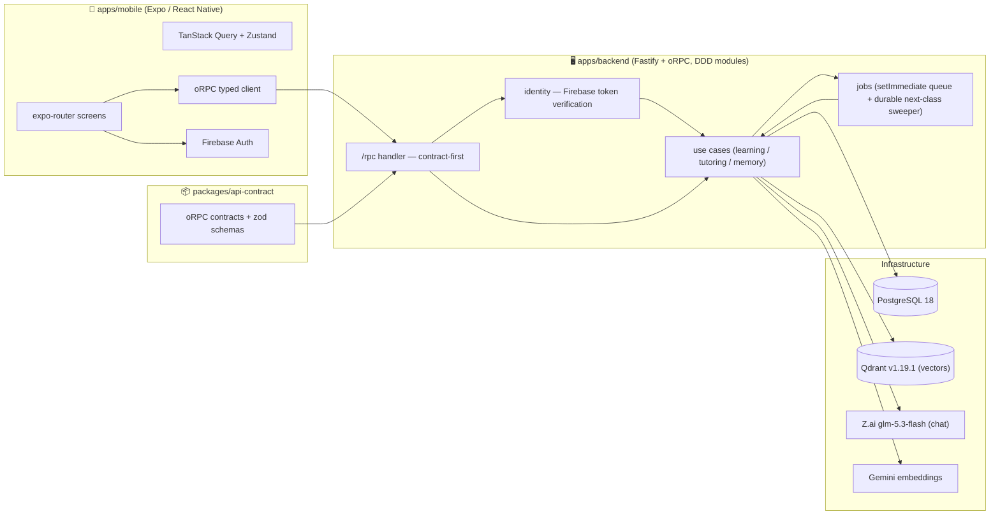

# Axon — System Architecture

> Status: **CURRENT as of 2026-10-12** (backend 46 test files / 310 tests green, mobile
> `tsc --noEmit` clean; TS 7.0.2, durable next-class job queue, class Q&A /
> Ask-AI, skill.progress, AI token-usage capture + `usage.report`, `stats.overview`,
> `skill.mistakes`, QA context layering + vector memory, the mastery-ledger spaced
> review), and **AI-attempt analytics + observability** (AiAttempt table, pino JSON
> logs → CloudWatch metric filters/alarms/dashboards — `knowledge-base/ANALYTICS.md`;
> mobile Firebase Crashlytics + Analytics) shipped; loop live-verified by
> `e2e-qa-context.mts` SMOKE_PASS 2026-10-02).
> Execution authority for what is next:
> `knowledge-base/BUSINESS_DECISIONS.md` §4 (post-backlog horizon — first levers landed,
> see §4.4). Beta history:
> `knowledge-base/BETA_PLAN.md` and `knowledge-base/PHASE6_HARDENING.md` (both DONE).
> Background: `CONCEPT.md` (vision), `BUSINESS_DECISIONS.md` (decision record), `GAPS.md`
> (gap ledger), `PHASE3_4_ADAPTIVE_LOOP.md`
> (how the loop was built).
> Deployment (production): `knowledge-base/DEPLOY_AWS_SERVERLESS.md` (Lambda
> `axon-api` + `axon-worker` behind API Gateway HTTPS, Postgres on Neon free
> (pooled endpoint), vectors on Qdrant Cloud free; one container image, both
> functions, `LAMBDA_ROLE` dispatch; worker drains the durable job queues on an
> EventBridge minute tick). Superseded beta: `knowledge-base/DEPLOY_AWS_BETA.md`
> (EC2 t2.micro, terminated 2026-10-02).

## 1. One-paragraph summary

Axon is an **adaptive, AI-generated learning app**. A user enters a *topic*; the backend expands
it into a *skill* (Markdown lesson + quiz + retrievable context snippets) and delivers the lesson
as a sequence of *classes*. The user reads a class, answers its quiz; the scored answers plus a
per-user vector memory feed back into the model to generate the *next* class, so the curriculum
adapts to what the user actually gets wrong. Memory lives in **Qdrant** (`axon_vectors`); Postgres
is relational truth.

## 2. High-level architecture



Dev stack (`docker-compose-dev.yaml`): backend, `postgres:18` (5432), `qdrant/qdrant:v1.19.1`
(6333 REST / 6334 gRPC). RabbitMQ is **not** declared in dev anymore (removed as unused,
Phase 7 S6) but stays deployed in prod per business decision M7; `JobQueuePort` remains the
seam for a broker later.

## 3. Repo layout (pnpm monorepo)

```
axon/
├── apps/
│   ├── backend/          ← Fastify + oRPC API (TypeScript, tsx dev runner, vitest)
│   └── mobile/           ← Expo / React Native (expo-router, NativeWind, react-native-reusables)
├── packages/
│   └── api-contract/     ← Shared oRPC contracts + zod schemas (tsup build → dist/)
├── docker-compose-dev.yaml / docker-compose-prod.yaml / Dockerfile
├── .env.example          ← env documentation (root .env is gitignored)
└── pnpm-workspace.yaml   ← apps/*, packages/*  (packageManager: pnpm@10.14.0)
```

Build order matters: `pnpm --filter @axon/api-contract build` before the backend resolves
`@axon/api-contract` from `dist/`.

## 4. Backend — DDD modular monolith

Layering: `router/` (thin oRPC wiring) → `modules/*/api` (handlers: parse → use case → error
mapping) → `modules/*/application` (use cases, curried over a deps object = future Effect Layer)
→ `modules/*/domain` (pure types + functions + tagged errors + repository ports) →
`modules/*/infrastructure` (Prisma / Qdrant / Z.ai / Firebase adapters). `main.ts` bootstraps
Fastify; `container.ts` is the composition root — the only place adapters are constructed.

```
apps/backend/src/
├── main.ts                Fastify bootstrap
├── container.ts           composition root (adapters → use cases → routers/job handlers)
├── router/index.ts        buildRouters(container)
├── modules/
│   ├── platform/          Result<T,E>, tagged errors, toORPCError, ports (Clock/JobQueue),
│   │                      config.ts, prisma client, set-immediate job queue
│   ├── identity/          Firebase email/password + Google; per-request ID-token verification
│   │                      → context.user; authenticate use case + middleware (unit-tested)
│   ├── learning/          Skill/Class/Question/Event domain, queries+commands
│   │                      (create-skill, edit-skill, submit-quiz, get-skill-*), Prisma repos,
│   │                      oRPC handlers, skill status state machine (canTransition)
│   ├── tutoring/          AiPort, personas (TUTOR_SYSTEM/METADATA_SYSTEM), prompt builders,
│   │                      defensive JSON parsing, zai.client adapter (chat + embeddings),
│   │                      generate-skill-metadata + generate-first-lesson +
│   │                      generate-next-class use cases
│   ├── memory/            VectorStorePort (Prisma metadata + Qdrant points),
│   │                      retrieve-relevant-context policy (degrades to [] on failure)
│   └── jobs/              registry: "skill-init", "skill-first-lesson", "skill-next-class" → handlers
└── src/prisma/            schema + migrations + generated client
```

Import rules (Effect readiness): `domain/` has zero infra imports; errors are plain tagged
objects (`{ kind: "SkillNotFound" }`); use cases return `Result<T, E>` curried over deps;
only `infrastructure/` imports prisma/qdrant/ai SDKs; only `container.ts` constructs adapters.

### 4.1 RPC surface (all routes under `/rpc`, Firebase bearer token required)

| Route | Purpose |
|---|---|
| `skill.create` | persist the learner's freeform prompt as a GENERATING shell (placeholder topic = clipped prompt, full brief on `Skill.prompt`) + enqueue `skill-init` |
| `skill.edit` | ownership-checked topic/description update; on a lesson-less ACTIVE skill it IS the draft acceptance → GENERATING + arm `skill-first-lesson` |
| `skill.get` / `skill.list` | read skill (+`status`); list includes lessonCount/completedLessons/learnedPoints/lastActivityAt; optional `includeArchived` (default false hides ARCHIVED) |
| `skill.updateStatus` | user-settable lifecycle: PAUSED/ACTIVE/COMPLETED/ARCHIVED (state-machine-guarded, 409 on illegal; GENERATING/FAILED machine-managed) |
| `skill.retry` | FAILED → GENERATING + re-enqueue the failed stage: `skill-first-lesson` when a draft exists, else `skill-init` from the stored prompt (ownership-checked, state-machine-guarded) |
| `skill.mistakes` | latest wrong answer per question, newest first (correct retakes heal the question; pending open-ended excluded; OPEN_ENDED `correctAnswer` stays null server-side) |
| `class.qa.ask` | anchor a learner question into a class conspect: persists a `PENDING` `ClassQaBlock` (with the verbatim `anchorText` selection when the learner long-press-selected, Phase 8) and enqueues the in-process answer job → `{blockId, status}` |
| `class.qa.list` | Q&A blocks for a class, ascending `(anchorParagraph, createdAt, id)` — the client polls while any block is `PENDING` |
| `quiz.get` | questions for a class (answerKey stripped) |
| `stats.overview` | learning stats: 8-week weekly active skills, day streak, lessons completed this week, per-skill totals (ISO weeks Mon 00:00 UTC, live derived) |
| `stats.report` | AI usage & cost per user: chat tokens by kind (init/next-class/QA) from event payloads, embedding tokens from `SUM(Vector.tokenCount)`, estimated USD; gap counters, optional `skillId` filter |

Error mapping via `toORPCError`: `*NotFound` and `NotOwned` → 404 (NotOwned hides behind 404

### 4.2 The create-with-prompt flow + the adaptive loop (the product)

1. **Create** (`skill.create`): the learner writes a freeform prompt — what they want to
   learn, goal, level (textarea, max 4000 chars). The shell persists `GENERATING` with the
   prompt clipped to 255 chars as a placeholder `topic` and the full brief on
   `Skill.prompt` (migration `20261017073000_add_skill_prompt`); `skill-init` is enqueued.
2. **Metadata draft** (`generate-skill-metadata`, the `skill-init` job): one AI call
   (`METADATA_SYSTEM` + `SKILL_METADATA_SCHEMA`) turns the prompt into a title +
   description → audited as `SKILL_CREATED` (action `skill_metadata`; the usage report's
   `skillInit` bucket reads this event) → persists both and settles **ACTIVE with zero
   classes** — the client shows the draft for review. Any failure → `FAILED` +
   `ERROR_OCCURRED`; `skill.retry` re-enters stage 1 from the stored prompt.
3. **Acceptance** (`skill.edit` on a lesson-less `ACTIVE` skill): the learner edits and
   saves the draft (mobile `ReviewSkill` screen — title + description, both editable,
   FAILED offers retry). The edit is ownership-checked, saves the fields, flips
   `GENERATING` and arms the `skill-first-lesson` job. Any later edit (classes exist) is
   a plain field update.
4. **First lesson** (`generate-first-lesson`, the `skill-first-lesson` job): **retry
   guard first — if any class already exists (`findTopBySkill`), skip generation entirely
   and let the success path flip ACTIVE** (a rerun can never violate
   `UNIQUE(skillId, index)`; a partially-persisted failure heals to ACTIVE with retrieval
   degrading to `[]` for its missing vectors — accepted beta cost). Otherwise:
   prior-context retrieval (Qdrant, filtered by userId, excludes own skill, degrades to
   []) → one JSON generation briefed with the stored prompt + the accepted description
   (class 0 + MC/TF + 1–2 open-ended questions + `lessonSummary` + context snippets) →
   `CLASS_GENERATED` audit event (action `first_lesson`, full prompt+response) → persist
   class/questions → embed summary+snippets in one call → vectors: summary `AI_NEXT`,
   snippets `AI_INITIAL`, `classIndex 0` (best-effort: a vector-store outage does not
   fail the persisted lesson) → status `ACTIVE`. Any failure → status `FAILED` +
   `ERROR_OCCURRED` event. glm-5.3-flash JSON drift is handled by `extractJsonObject` +
   per-field re-validation (`tutoring/domain/parse.ts`).
5. **Learn**: mobile submit → `quiz.submit` → `scoreAnswer` (MC/TF exact-match vs `answerKey`;
   open-ended persists `score/isCorrect = null` and is graded asynchronously —
   open-ended generation unlocked (S5)) → `Answer` rows → submit-quiz enqueues
   `skill-next-class` (durable marker + GENERATING flip).
   It also enqueues `skill-answer-vectors` to mine the wrong MC/TF answers (cap 10/submit) into
   `ANSWER_DERIVED` vectors keyed by `answerId` (deduped per answer, best-effort degrade), and
   `grade-open-ended` grades open-ended answers in one batched AI call (feedback merges into
   `Answer.content` as `{ answer, feedback }`).
6. **Next class** (`generate-next-class`): load skill + highest class (`findTopBySkill`) + this
   user's answers (latest attempt per question) → **mastery ledger** (pure
   `learning/domain/quiz/review-schedule.ts` over `findReviewCandidatesBySkill`: standing
   wrongs → `reteach`, shaky heals → `reinforce`, stale-correct ≥3 days → `spiral` (cap 2);
   overall cap 5, newest-first within tier, newest class excluded — its mistakes already feed
   the dedicated block) → retrieval **without** `excludeSkillId`
   (own history wanted; topK 12) → prompt = TUTOR_SYSTEM + topic + last title/summary +
   known-gaps block (ANSWER_DERIVED memory) + **mastery-ledger block**
   (re-test freshly phrased: new angle/example/question type, never the earlier wording) +
   mistake block (or "all correct — raise difficulty") + history blocks ("Already covered —
   build on it") → JSON generation (init shape + `lessonSummary`) → `CLASS_GENERATED` event →
   persist class at `index + 1` + questions → embed summary (`AI_NEXT`) + snippets
   (`AI_INITIAL`) at the new classIndex. Status settles back to `ACTIVE`.
   **Retake dedup**: the use case skips (returns ok, no event, no AI call) when the learner's
   highest answered class index (`QuizRepository.findHighestAnsweredClassIndex`) is behind the
   newest class — a consecutive retake of the newest lesson no longer spawns variants.
7. **Observe**: after acceptance the client routes to the skill's lesson list; SkillDetail
   shows the skeleton row while the skill is `GENERATING` — no client-side polling of
   generation beyond the 10 s list polls. The home skill list polls `skill.list` every 10 s
   while visible.

### 4.3 Skill status lifecycle

`GENERATING → ACTIVE | FAILED`, `FAILED → GENERATING` (retry), `ACTIVE ↔ PAUSED`,
`→ COMPLETED → ARCHIVED` — enforced by pure `canTransition` (`learning/domain/skill/skill.ts`).
Migrations `20260921*_skill_status_*` added `GENERATING`/`FAILED` and backfilled legacy `DRAFT`
rows (≥1 class → `ACTIVE`, else `FAILED`). User-settable transitions go through
`skill.updateStatus`; a paused skill's submits still score but `generate-next-class` no-ops
unless the skill is ACTIVE or mid-GENERATING (pause gates generation).

Generation trigger is durable since `5902e68`: `submit-quiz` writes a `NextClassJob` marker
(unique per skill, lease-claimed, attempt-capped with requeue) processed by a
worker; a sweeper/reconciler recovers stale or lost signals on boot and interval. The
prompt-flow stages run in-process (no durable row): the `skill-init` sweeper re-enqueues
lost stage jobs on stale GENERATING skills (branching on description presence), heals an
abandoned review (ACTIVE, lesson-less, stale) as implicit acceptance, and settles a
GENERATING skill whose class persisted but whose pipeline died before settling.

### 4.4 AI token accounting

**Capture (write side).** The `AiPort` results carry optional usage —
`usage: { promptTokens, completionTokens }` on chat results, `{ tokens }` on the batched
embedding result — read off the OpenAI-compatible responses by `zai.client.ts` and simply
absent when an endpoint omits them (degrade = absent, never guessed). The three audit sites
(`SKILL_CREATED`, `CLASS_GENERATED`, `QA_ANSWERED`) embed `payload.usage`; embedding tokens
land as `Vector.tokenCount` on every vector the batch produces (exact-sum split via the pure
`embeddingTokenCounts` helper) — written by all three vector paths (init, next-class,
answer-memory mining). A correct first step before any modeling: billing data now accrues
with the events themselves.

**Report (read side).** `stats.report` (`usage.report`) prices one user's AI spend:
chat tokens per kind (skillInit / nextClass / qa) from the event payloads' `usage`,
embedding tokens from `SUM(Vector.tokenCount)` (`VectorMetadataRepository.sumTokenCountsByUser`),
USD via the diffable rate table `learning/domain/event/pricing.ts` (`estimateCostUsd`).
Gaps are counted, never estimated: `eventsWithoutUsage` (payload lacks usage) and
`vectorsWithoutTokenCount` (capture degrade). Known unaccounted: grading calls (no audit
event) and retrieval query embeddings (no persisted vectors). Per-user scope only —
optional `skillId` filter, ownership-checked; no admin surface.

### 4.5 Class Q&A pipeline (Phase 8)

`ask-class-question` persists a `PENDING` `ClassQaBlock` (question, `anchorParagraph`,
verbatim `anchorText` when the learner selected text) and enqueues `class-qa-answer`. The
answer job assembles a **priority-layered prompt** (`buildQaAnswerPrompt`, D1): L1 the
learner's verbatim selection (fallback: the anchored block's excerpt via the backend splitter
`memory/domain/split-conspect.ts`) + typed question → L2 the whole current lesson → L3 the
class's last 5 ANSWERED blocks as **anchored annotations** (passage → learner-typed →
you-answered; the header forbids chat-mode continuation) → L4 skill title/description +
sibling lesson outline → L5 skill-scoped + cross-skill similarity hits labeled "background,
lower trust". Layers degrade silently (empty history, retrieval failure = skipped layer).
Author attribution is structural (D6): every learner-typed string is fenced under "The
learner typed", Axon-authored content is labeled as Axon's, and a shared `ATTRIBUTION_RULE`
fragment is appended verbatim to all five personas.

Memory: after the relational commit both generation paths enqueue `class-content-vectors`
(one `CONTENT_CHUNK` vector per top-level conspect block, deduped per class); the answer job
lazily backfills pre-Phase-8 classes inline before answering; after a successful answer,
`qa-block-vectors` mines the exchange into a `QA_DERIVED` vector keyed by `qaBlockId`
(attributed snippet, "Questions the learner asked" block in `buildNextClassPrompt`).
Retrieval (`retrieve-qa-context`) embeds question+selection once and runs two filtered
searches: `searchSimilar({skillId, topK 6})` and `searchSimilar({excludeSkillId, topK 4})` —
the `VectorStorePort.searchSimilar` input gained the positive `skillId` filter. Failures
degrade to empty hit lists, never an error.

## 5. Data model

```mermaid
erDiagram
    User ||--o{ Skill : owns
    User ||--o{ Answer : submits
    User ||--o{ Session : has
    User ||--o{ Event : logs
    Skill ||--o{ Class : contains
    Skill ||--o{ Question : has
    Skill ||--o{ Answer : collects
    Skill ||--o{ SkillProgress : tracks
    Skill ||--o{ Event : logs
    Skill ||--o{ Vector : embeds
    Class ||--o{ Vector : embeds
    Class ||--o{ Question : contains
    Question ||--o{ Answer : receives
    Answer ||--o{ Vector : derives
```
Key tables: `Skill` (topic, description, status, requestId UK), `Class`
(UNIQUE(skillId, index), contentMd, aiModel), `Question` (type, text, choices, answerKey
server-side only), `Answer` (content json, score, isCorrect, timeSpentMs), `Event` (audit:
SKILL_CREATED, CLASS_GENERATED, CLASS_OPTIONS_GENERATED, ANSWER_SUBMITTED, CONTEXT_SELECTED,
ERROR_OCCURRED, QA_ANSWERED — payloads include the full AI prompt+response; generation/QA/options
payloads also carry token `usage`. The `VECTOR_UPSERTED` enum value exists but nothing records it),
`Vector` (relational metadata only:
skillId/classId/answerId/qaBlockId/source/textSnippet/classIndex/tokenCount), `ClassQaBlock` (learner
question anchored at `anchorParagraph` in a class conspect, with the verbatim `anchorText`
selection when provided; flat blocks, `question`/nullable
`answer`, status `PENDING|ANSWERED|FAILED`, answered asynchronously by the `class-qa-answer`
job; `contentMd` itself stays untouched),
`SkillProgress` (snapshot json — **unused**).

Enums: **SkillStatus** `DRAFT(legacy) | GENERATING | ACTIVE | FAILED | PAUSED | COMPLETED |
ARCHIVED` · **QuestionType** `MULTIPLE_CHOICE | TRUE_FALSE | OPEN_ENDED`
(all three types generated since S5; MC/TF graded synchronously, open-ended async via
grade-open-ended) · **VectorSource** `AI_INITIAL | AI_NEXT | ANSWER_DERIVED | CONTENT_CHUNK |
QA_DERIVED` (Phase 8: conspect blocks + mined Q&A) · **ClassQaStatus**
`PENDING | ANSWERED | FAILED`.

Embeddings live only in Qdrant (`axon_vectors`, 3072-dim Cosine, payload indexes userId/skillId,
point id = `Vector.id`); Postgres keeps metadata. Embedding model: `gemini-embedding-2` via the
Gemini OpenAI-compatible endpoint; chat: `glm-5.3-flash` via `https://api.z.ai/api/coding/paas/v4`.

## 6. Mobile (apps/mobile)

Flow: Firebase auth → skill list (home; polls `skill.list` every 10 s while visible;
`GENERATING` rows show a preparing state, pull-to-refresh, pinning; `FAILED` rows show a
"Failed to prepare" chip with a retry affordance) → create-skill (freeform prompt
textarea) → review skill (AI-drafted title/description) → skill
detail ("Preparing your next lesson…" while `GENERATING`; FAILED shows error copy + retry
button) → class list (newest first) → class
screen (Markdown conspect + quiz tabs; native text selection "Ask AI" creates an anchored
Q&A block via `class.qa.ask` (the verbatim selection rides along as `anchorText`, and the
card quotes the stored selection over the chunk preview), and the screen polls
`class.qa.list` while any block is `PENDING`) → quiz (MC/TF/Open) →
result → "continue" returns to the skill's lesson list; generation completes server-side and
surfaces as the preparing state above.

- **RPC client** (`utils/rpc.ts`): typed oRPC client; bearer Firebase ID token attached per call
- **State**: TanStack Query for server data; Zustand (`quiz.store`) for in-screen answers.
- **Theme**: Source Sans 3 + blue-tinted light/dark palettes; `lib/theme.ts` (RN styles) and
  `global.css` (NativeWind vars) kept in lockstep via the `theme:check` script. Conspects:
  markdown rendering, karaoke read-aloud, syntax-highlighted code, selectable text
  (`components/class/`, `lib/conspect-markdown.tsx`).
  Read-aloud (2026-10-18): mixed-language lessons tag speech runs at
  generation — the tutor emits `[[lang:xx]]…[[/lang]]` markers plus required
  `baseLanguage`/`contentLanguages` JSON fields (validated post-parse,
  retryable) — and the mobile player routes English runs to the bundled
  Kokoro-82M engine and everything else to the system engine with the chunk
  language as a voice hint (`lib/conspect-speech/`, `hooks/use-conspect-speech.ts`).
  Markers never render: stripped in `ClassConspect`, `ConspectMarkdown`, and
  QA excerpts. The 152 MB Kokoro model ships in EAS builds via `.easignore`
  (EAS reads it instead of `.gitignore`; the model stays out of git).

## 7. Environment & config

`.env.example` documents the root `.env`:

| Key | Used for |
|---|---|
| `DATABASE_URL` | Prisma → Postgres |
| `GEMINI_API_KEY` | Gemini embeddings |
| `APP_PORT` / `APP_HOST` / `NODE_ENV` | HTTP bind (compose maps 3001:3001) |

`modules/platform/config.ts` is the single config module (env-over-default).
Prisma upgraded 6.15.0 → 6.19.3 (2026-10-01) for Postgres 18 support (6.15.0 broke `$queryRaw`/`$transaction` with "Failed to obtain server version"); vectors/grading/auth raw+transaction channels live-verified against the PG18 dev DB — note the containerized backend still bundles 6.15.0 in its image and its boot regenerates the shared `src/prisma/generated` dir, so re-run `pnpm --filter @axon/backend run prisma:generate` on the host after container restarts.

## 8. Tests

Vitest, colocated `*.test.ts` + `modules/loop.integration.test.ts` (48 files / 327 tests, all
green 2026-10-17): scoring, skill state machine, Result, authenticate + Firebase verifier +
auth middleware, create-skill (prompt shell + placeholder topic), retry-skill (stage
branching), edit-skill (acceptance trigger/ownership), mine-answer-vectors (dedup/cap/degrade),
grade-open-ended (batch/degrade/partial), open-ended generation unlock (enum/instruction/drift
guard), set-skill-status (whitelist/state-machine/NotOwned), next-class pause guard,
get-skill-progress (zeros / partial / completed / NotOwned / NotFound), generate-skill-metadata
(persist/settle/audit/failure shapes), generate-first-lesson (retry-guard replay, prompt+
description brief, audit, failure shapes), generate-next-class (incl. retake-dedup cases), submit-quiz
(trigger + dedup cases), review-schedule (reteach/reinforce/spiral tiers, caps, staleness,
newest-class exclusion), prompt builders (mastery-ledger block, first-lesson shape),
the next-class durable queue (worker retry/release-at-cap, sweeper claim loop, reconciler
stale-pending requeue), class Q&A (ask → PENDING block + enqueue + contract
validation incl. `anchorText` bounds, list ordering/ownership, answer generation
PENDING→ANSWERED/FAILED with replay no-ops, stranded-block requeue on boot), and the
composed loop integration test (real use cases + in-memory
fakes over `modules/testing/fakes.ts`: prompt create → metadata draft → acceptance → first
lesson → submit → next-class → retake dedup → FAILED/retry heal for both stages, the Phase 8
QA scenario — anchored ask →
layered prompt evidence → CONTENT_CHUNK backfill → QA_DERIVED mining dedup → follow-up
annotation block). Post-backlog additions: AiPort usage capture
(payload `usage` / `Vector.tokenCount` persisted; absent-usage degrade), `embeddingTokenCounts`
(exact-sum batch split), `stats.overview` + its calendar domain (ISO weeks / streak / lesson
coverage), `skill.mistakes` (wrong-only, retake heals, open-ended feedback without the model
answer), `latestWrongPerQuestion` (latest-wins then wrong-filter), `usage.report` +
`pricing` (per-kind sums, gap counters, rate math). Phase 8 additions: `split-conspect`
(backend splitter mirroring the client's block rules), `vectorize-class-content` (one-shot
per-class chunk embedding, dedup + full degrade), `retrieve-qa-context` (one embedding, two
filtered searches, per-group degrade), `mine-qa-vectors` (block-keyed dedup + degrade), the
attribution contract (`prompts.test.ts`: author labels in every builder + persona rule), and
the layered `buildQaAnswerPrompt` structure tests (order, caps, optional-layer omission).
Live verification: `e2e-qa-context.mts` on the dev stack (real Postgres/Qdrant/AI) —
SMOKE_PASS 2026-10-01.
## 9. Known gaps → post-beta backlog

**Phase 7 COMPLETE (2026-09-30) — all seven audit items closed.** Original audit: `knowledge-base/PHASE7_POST_BETA.md`
(written 2026-09-22 from a verified audit). What fed it:

1. Unused `rabbitmq` container in dev compose → Phase 7 S6 (delete; broker stays a
   `JobQueuePort` seam).
2. No per-skill progress breakdown → S1; `SkillProgress` table stays unused by design (D1).
3. PAUSED/COMPLETED/ARCHIVED unreachable → S2 (status lifecycle UX).
4. `ANSWER_DERIVED` vectors / `Vector.answerId` unused → S3 (answer memory) — done (S3, 2026-09-30).
5. Open-ended ungeneratable and ungradable → S4 (background AI grading) + S5 (generation
   unlock) — grading done (S4, 2026-09-30); generation unlock = S5; generation unlocked (S5).
6. Non-transactional class+question persist → S6 (`createWithQuestions` `$transaction`).
7. Dead `Skill.lambda` / `LAMBDA_DECAY_DEFAULT` → S7 (delete, not tune).

Post-backlog horizon (BUSINESS_DECISIONS §4), first levers landed 2026-10-01: §4.2 AI spend —
token capture at the AiPort boundary + `usage.report`; §4.3 retention signal — `stats.overview`
and `skill.mistakes` (see §4.4). Outstanding: live emulator visual pass + the deferred
StatsCard/MistakeList mounts; docs for the remaining §4 items unchanged (no growth push, no
monetization).
