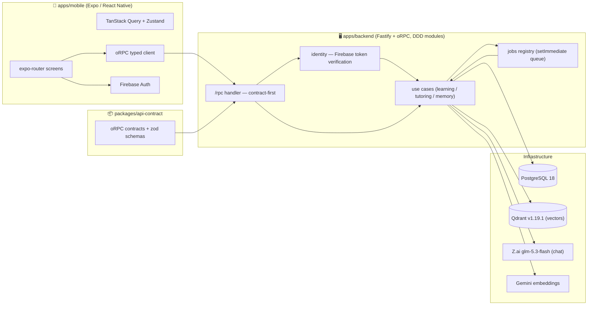

# Axon — System Architecture

> Status: **CURRENT as of 2026-09-21** (rewritten after the Phase 3+4 adaptive loop; updated
> when Phase 6 beta hardening landed). Authoritative plan docs: `knowledge-base/BETA_PLAN.md`
> (sequencing), `knowledge-base/PHASE6_HARDENING.md` (beta hardening, now DONE). Background:
> `CONCEPT.md` (vision), `GAPS.md` (gap ledger), `PHASE3_4_ADAPTIVE_LOOP.md` (how the loop was
> built).

## 1. One-paragraph summary

Axon is an **adaptive, AI-generated learning app**. A user enters a *topic*; the backend expands
it into a *skill* (Markdown lesson + quiz + retrievable context snippets) and delivers the lesson
as a sequence of *classes*. The user reads a class, answers its quiz; the scored answers plus a
per-user vector memory feed back into the model to generate the *next* class, so the curriculum
adapts to what the user actually gets wrong. Memory lives in **Qdrant** (`axon_vectors`); Postgres
is relational truth.

## 2. High-level architecture



Dev stack (`docker-compose-dev.yaml`): backend, `postgres:18` (5432), `qdrant/qdrant:v1.19.1`
(6333 REST / 6334 gRPC), `rabbitmq:3.12-management` — **the RabbitMQ container is declared but
unused** (no amqplib dependency or code; `JobQueuePort` is the seam for a broker later).

## 3. Repo layout (pnpm monorepo)

```
axon/
├── apps/
│   ├── backend/          ← Fastify + oRPC API (TypeScript, tsx dev runner, vitest)
│   └── mobile/           ← Expo / React Native (expo-router, NativeWind, react-native-reusables)
├── packages/
│   └── api-contract/     ← Shared oRPC contracts + zod schemas (tsup build → dist/)
├── docker-compose-dev.yaml / docker-compose-prod.yaml / Dockerfile
├── .env.example          ← env documentation (root .env is gitignored)
└── pnpm-workspace.yaml   ← apps/*, packages/*  (packageManager: pnpm@10.14.0)
```

Build order matters: `pnpm --filter @axon/api-contract build` before the backend resolves
`@axon/api-contract` from `dist/`.

## 4. Backend — DDD modular monolith

Layering: `router/` (thin oRPC wiring) → `modules/*/api` (handlers: parse → use case → error
mapping) → `modules/*/application` (use cases, curried over a deps object = future Effect Layer)
→ `modules/*/domain` (pure types + functions + tagged errors + repository ports) →
`modules/*/infrastructure` (Prisma / Qdrant / Z.ai / Firebase adapters). `main.ts` bootstraps
Fastify; `container.ts` is the composition root — the only place adapters are constructed.

```
apps/backend/src/
├── main.ts                Fastify bootstrap
├── container.ts           composition root (adapters → use cases → routers/job handlers)
├── router/index.ts        buildRouters(container)
├── modules/
│   ├── platform/          Result<T,E>, tagged errors, toORPCError, ports (Clock/JobQueue),
│   │                      config.ts, prisma client, set-immediate job queue
│   ├── identity/          Firebase email/password + Google; per-request ID-token verification
│   │                      → context.user; authenticate use case + middleware (unit-tested)
│   ├── learning/          Skill/Class/Question/Event domain, queries+commands
│   │                      (create-skill, edit-skill, submit-quiz, get-skill-*), Prisma repos,
│   │                      oRPC handlers, skill status state machine (canTransition)
│   ├── tutoring/          AiPort, personas (TUTOR_SYSTEM/DESCRIPTION_SYSTEM), prompt builders,
│   │                      defensive JSON parsing, zai.client adapter (chat + embeddings),
│   │                      generate-initial-skill + generate-next-class use cases
│   ├── memory/            VectorStorePort (Prisma metadata + Qdrant points),
│   │                      retrieve-relevant-context policy (degrades to [] on failure)
│   └── jobs/              registry: "skill-init", "skill-next-class" → handlers
└── src/prisma/            schema + migrations + generated client
```

Import rules (Effect readiness): `domain/` has zero infra imports; errors are plain tagged
objects (`{ kind: "SkillNotFound" }`); use cases return `Result<T, E>` curried over deps;
only `infrastructure/` imports prisma/qdrant/ai SDKs; only `container.ts` constructs adapters.

### 4.1 RPC surface (all routes under `/rpc`, Firebase bearer token required)

| Route | Purpose |
|---|---|
| `skill.create` | persist skill with status `GENERATING` + enqueue `skill-init` |
| `skill.edit` | edit topic/description (status transitions deliberately excluded — own command later) |
| `skill.get` / `skill.list` | read skill (+`status`); list includes lessonCount/completedLessons/learnedPoints/lastActivityAt |
| `skill.retry` | FAILED → GENERATING + re-enqueue `skill-init` (ownership-checked, state-machine-guarded) |
| `class.list` / `class.get` | classes per skill (`skillId` included) / class by id |
| `quiz.get` | questions for a class (answerKey stripped) |
| `quiz.submit` | score answers vs `answerKey`, persist `Answer` rows, `ANSWER_SUBMITTED` event, enqueue `skill-next-class` |

Error mapping via `toORPCError`: `*NotFound` and `NotOwned` → 404 (NotOwned hides behind 404
so skill existence is not leaked); `InvalidSkillTransition` → 409; anything else → 500.

### 4.2 The adaptive loop (the product)

2. **Init** (`generate-initial-skill`): **retry guard first — if any class already exists
   (`findTopBySkill`), skip generation entirely and let the success path flip ACTIVE** (a rerun
   can never violate `UNIQUE(skillId, index)`; a partially-persisted failure heals to ACTIVE
   with retrieval degrading to `[]` for its missing vectors — accepted beta cost). Otherwise:
   description (best-effort) → prior-context retrieval (Qdrant, filtered by userId, excludes
   own skill, degrades to []) → one JSON generation (class 0 + MC/TF questions + `lessonSummary`
   + context snippets) → `SKILL_CREATED` audit event (full prompt+response) → persist
   class/questions → embed summary+snippets in one call → vectors: summary `AI_NEXT`, snippets
   `AI_INITIAL`, `classIndex 0` → status `ACTIVE`. Any failure → status `FAILED` +
   `ERROR_OCCURRED` event. glm-5.3-flash JSON drift is handled by `extractJsonObject` +
   per-field re-validation (`tutoring/domain/parse.ts`).
3. **Learn**: mobile submit → `quiz.submit` → `scoreAnswer` (MC/TF exact-match vs `answerKey`;
   open-ended scores 0 — generation is restricted to MC/TF) → `Answer` rows → enqueue
   `skill-next-class`.
4. **Next class** (`generate-next-class`): load skill + highest class (`findTopBySkill`) + this
   user's answers (latest attempt per question) → retrieval **without** `excludeSkillId`
   (own history wanted; topK 12) → prompt = TUTOR_SYSTEM + topic + last title/summary +
   mistake block (or "all correct — raise difficulty") + history blocks ("Already covered —
   build on it") → JSON generation (init shape + `lessonSummary`) → `CLASS_GENERATED` event →
   persist class at `index + 1` + questions → embed summary (`AI_NEXT`) + snippets
   (`AI_INITIAL`) at the new classIndex. Status stays `ACTIVE`. **Retake dedup**: the use case
   skips (returns ok, no event, no AI call) when the learner's highest answered class index
   (`QuizRepository.findHighestAnsweredClassIndex`) is behind the newest class — a consecutive
   retake of the newest lesson no longer spawns variants. With no recorded answers the use case
   generates (safe default); retaking an older class still regenerates from the latest one.
5. **Observe**: mobile polls `class.list`; the class screen auto-navigates into the new lesson.

### 4.3 Skill status lifecycle

`GENERATING → ACTIVE | FAILED`, `FAILED → GENERATING` (retry), `ACTIVE ↔ PAUSED`,
`→ COMPLETED → ARCHIVED` — enforced by pure `canTransition` (`learning/domain/skill/skill.ts`).
Migrations `20260921*_skill_status_*` added `GENERATING`/`FAILED` and backfilled legacy `DRAFT`
rows (≥1 class → `ACTIVE`, else `FAILED`).

## 5. Data model

```mermaid
erDiagram
    User ||--o{ Skill : owns
    User ||--o{ Answer : submits
    User ||--o{ Session : has
    User ||--o{ Event : logs
    Skill ||--o{ Class : contains
    Skill ||--o{ Question : has
    Skill ||--o{ Answer : collects
    Skill ||--o{ SkillProgress : tracks
    Skill ||--o{ Event : logs
    Skill ||--o{ Vector : embeds
    Class ||--o{ Vector : embeds
    Class ||--o{ Question : contains
    Question ||--o{ Answer : receives
    Answer ||--o{ Vector : derives
```

Key tables: `Skill` (topic, description, status, lambda, requestId UK), `Class`
(UNIQUE(skillId, index), contentMd, aiModel), `Question` (type, text, choices, answerKey
server-side only), `Answer` (content json, score, isCorrect, timeSpentMs), `Event` (audit:
SKILL_CREATED, CLASS_GENERATED, ANSWER_SUBMITTED, CONTEXT_SELECTED, ERROR_OCCURRED,
VECTOR_UPSERTED — payloads include the full AI prompt+response for debugging), `Vector`
(relational metadata only: skillId/classId/answerId/source/textSnippet/classIndex/tokenCount),
`SkillProgress` (snapshot json — **unused**).

Enums: **SkillStatus** `DRAFT(legacy) | GENERATING | ACTIVE | FAILED | PAUSED | COMPLETED |
ARCHIVED` · **QuestionType** `MULTIPLE_CHOICE | TRUE_FALSE | OPEN_ENDED` (beta generates MC/TF
only) · **VectorSource** `AI_INITIAL | AI_NEXT | ANSWER_DERIVED(unused)`.

Embeddings live only in Qdrant (`axon_vectors`, 3072-dim Cosine, payload indexes userId/skillId,
point id = `Vector.id`); Postgres keeps metadata. Embedding model: `gemini-embedding-2` via the
Gemini OpenAI-compatible endpoint; chat: `glm-5.3-flash` via `https://api.z.ai/api/coding/paas/v4`.

## 6. Mobile (apps/mobile)

Flow: Firebase auth → skill list (home; `GENERATING` rows show a preparing state, pull-to-
refresh, pinning; `FAILED` rows show a "Failed to prepare" chip with a retry affordance) →
create-skill (topic input) → description/skill detail (FAILED shows error copy + retry button)
→ class list (newest first) → class screen (themed Markdown conspect + quiz tabs) → quiz
(MC/TF/Open) → result → **generating phase**: pulse + copy, polls `class.list` every 2.5 s
(90 s timeout), auto-navigates into the new lesson.

- **RPC client** (`utils/rpc.ts`): typed oRPC client; bearer Firebase ID token attached per call
  (transparent refresh). `EXPO_PUBLIC_API_URL` overrides the base URL; defaults stay
  `localhost` (web) / `10.0.2.2` (emulator).
- **State**: TanStack Query for server data; Zustand (`quiz.store`) for in-screen answers.
- **Theme**: atomics kit + light/dark monochrome system (`lib/theme.ts`); markdown theme for
  lessons (`components/class/`).

## 7. Environment & config

`.env.example` documents the root `.env`:

| Key | Used for |
|---|---|
| `DATABASE_URL` | Prisma → Postgres |
| `QDRANT_URL` | Qdrant (default `http://localhost:6333`) |
| `ZAI_API_KEY` | Z.ai chat (glm-5.3-flash) |
| `GEMINI_API_KEY` | Gemini embeddings |
| `FIREBASE_PROJECT_ID` | ID-token audience/issuer verification |
| `LAMBDA_DECAY_DEFAULT` | unused decay default (0.02) |
| `APP_PORT` / `APP_HOST` / `NODE_ENV` | HTTP bind (compose maps 3001:3001) |

`modules/platform/config.ts` is the single config module (env-over-default).

## 8. Tests

Vitest, colocated `*.test.ts` + `modules/loop.integration.test.ts` (12 files / 64 tests, all
green 2026-09-21): scoring, skill state machine, Result, authenticate + Firebase verifier +
auth middleware, create-skill, retry-skill, generate-initial-skill (incl. retry-guard cases),
generate-next-class (incl. retake-dedup cases), submit-quiz (8 cases incl. enqueue trigger),
and the composed loop integration test (real use cases + in-memory fakes over
`modules/testing/fakes.ts`: create → init → submit → next-class → retake dedup → FAILED/retry
heal, both failure shapes).

## 9. Known gaps → post-beta backlog

1. RabbitMQ container still declared in dev compose though unused.
2. `SkillProgress`, `ANSWER_DERIVED` vectors, open-ended AI grading, lambda decay — post-beta.
