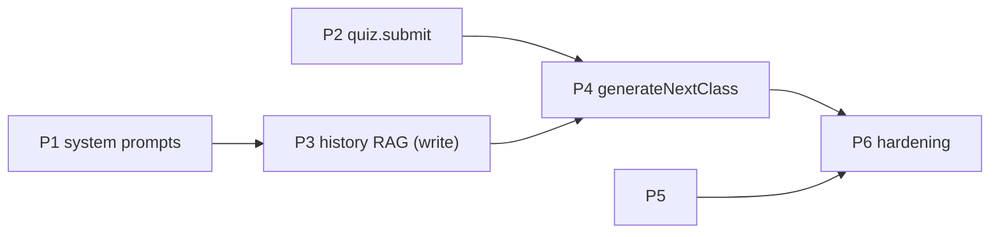

# Axon — Beta Execution Plan

> Written 2026-09-17 from a verified code audit (post-DDD-refactor state). This document
> **was** the authoritative next-actions plan through beta completion (2026-09-21); it is now
> history — follow `knowledge-base/PHASE7_POST_BETA.md`. ROADMAP.md sequencing and GAPS.md
> file references predate
> the 2026-09 refactor (they cite deleted `controllers/`, `middleware/auth.ts`, `ai.service.ts`)
> and are kept only as background. Goal: **working beta of the adaptive loop** — no
> over-engineering, every phase shippable on its own.
>
> ---
>
## Status update (2026-10-01)
- **Post-beta COMPLETE; post-backlog first levers landed through `16be97a`** — AI token
  capture + `usage.report`, `stats.overview` (streak/weekly activity), `skill.mistakes`
  review list. 30 files / 201 backend tests green; mobile `tsc --noEmit` clean. Horizon:
  `knowledge-base/BUSINESS_DECISIONS.md` §4.

## Status update (2026-09-30)
- **Phase 7 post-beta COMPLETE** — S1 progress UI, S2 status lifecycle, S3 answer memory, S4
  open-ended grading, S5 open-ended generation, S6 transactional persist + compose cleanup,
  S7 lambda deletion, S8 docs sync. 23 files / 145 backend tests green. Horizon:
  `knowledge-base/BUSINESS_DECISIONS.md` §4.

## Status update (2026-09-22)
- **Execution authority has moved to `knowledge-base/PHASE7_POST_BETA.md`** — the post-beta
  phase (progress UI, status lifecycle UX, ANSWER_DERIVED answer memory, open-ended AI
  grading, platform hygiene). This file is the completed beta plan, kept as history.

## Status update (2026-09-21, after Phase 6)
- **Phases 1–5 + Auth + Phase 6 — ALL DONE.** Beta hardening landed 2026-09-21 per
  `knowledge-base/PHASE6_HARDENING.md`: init retry guard (skip-if-class-exists), `skill.retry`
  (NotOwned → 404, `InvalidSkillTransition` → 409, re-enqueues `skill-init`), retake dedup
  (`findHighestAnsweredClassIndex` skip in `generate-next-class`), composed loop integration
  test, `EXPO_PUBLIC_API_URL`, mobile FAILED chip/banner + retry, and a real production image
  (backend emits `dist/`; Dockerfile `production` stage; compose fixed — container boots
  `/health` with migrations applied). Backend suite: 64/64 passing; mobile `tsc --noEmit`
  clean. Docs synced (ARCHITECTURE, GAPS).
- Remaining work is the post-beta backlog only (ARCHITECTURE.md §9).

## 0. Verified current state (what is actually done)

### Working today
| Capability | Evidence |
|---|---|
| `skill.create` → DRAFT skill + `skill-init` job (setImmediate queue) | `modules/learning/application/commands/create-skill.ts`, `modules/platform/infrastructure/set-immediate-jobs.ts` |
| Init pipeline: description (best-effort) → prior-context retrieval → class 0 + 5–10 questions + context snippets → `SKILL_CREATED` event → persist class/questions/`AI_INITIAL` vectors | `modules/tutoring/application/generate-initial-skill.ts` |
| Qdrant: collection `axon_vectors` (3072, Cosine), payload indexes `userId`/`skillId`, `upsert` + filtered `searchSimilar` | `modules/memory/infrastructure/qdrant.client.ts`, `vector.metadata.repo.ts` |
| Retrieval feeds init generation (topK 5, `userId` filter, excludes own skill); failure degrades to no-context | `modules/memory/application/retrieve-relevant-context.ts` |
| Mobile: create topic → `rpc.skill.create` → description screen (polls 2 s) → skill list → class list → lesson markdown → quiz rendering (MC/TF/Open) | `apps/mobile/components/skill/*`, `components/quiz/*`, `components/class/*` |
| Pure scoring domain fn (MC/TF exact match vs `answerKey`; open-ended scores 0) with tests — **unused** | `modules/learning/domain/quiz/scoring.ts` |
| Contract has `submit` route + input/output schemas — **not exported**, output schema wrong (echoes questions instead of a result) | `packages/api-contract/src/contract/quiz.contract.ts`, `schema/quiz.schema.ts` |

### Not built (the four asks + blockers)
1. **No system prompt anywhere.** `openrouter.client.ts` sends a single `user` message per
   request (`messages: [{ role: "user", content: prompt }]`).
2. **No history RAG.** Only `AI_INITIAL` context snippets are embedded. Lesson content/summaries
   are never vectorized; `VectorSource.AI_NEXT` is unused; retrieval is bound only to init, not
   to follow-up lessons.
3. **No `generateNextClass`.** It was deleted in the refactor and never re-added — the adaptive
   loop (the product) does not exist.
4. **`quiz.submit` dead end-to-end.** No handler, no `Answer` persistence; mobile Submit is
   `console.log('submit')` (`components/quiz/Quiz.tsx:36`).
5. **Lesson rendering is bare.** `ClassConspect.tsx` = `<Markdown>{contentMd}</Markdown>` — no
   theme, no loading/error states, no lesson chrome.
6. **Status never leaves `DRAFT`.** Client infers readiness from description appearing; no
   GENERATING/ERROR distinction, no retry.

## Guiding constraints (keep beta simple, keep seams)
- Keep the DDD module layout and ports (`AiPort`, `VectorStorePort`, `JobQueuePort`, repos) and
  the `container.ts` composition root exactly as they are. New capability = new use case + job
  registry entry, not new architecture.
- **No RabbitMQ, no auth, no Effect migration in beta.** setImmediate job queue and hard-coded
  user 1 are accepted (identity module boundary stays for later).
- Retrieval failure degrades to "no context", never blocks generation (existing policy — keep).
- Postgres stays relational truth; Qdrant stores vectors + payload only (existing split — keep).
- **Beta generates only MC + TF questions.** Open-ended auto-scores 0 (`scoring.ts`), so
  generating it is bad UX. Restrict in the generation schema until AI grading exists (post-beta).

---

## Phase 1 — System prompts with roles (all AI requests) — ✅ DONE (2026-09-18)
> Detailed execution plan: `knowledge-base/PHASE1_SYSTEM_PROMPTS.md` (exact edits, personas,
> verification queries).

**Files:** `tutoring/ports.ts`, `tutoring/infrastructure/openrouter.client.ts`,
`tutoring/domain/prompts.ts` (extend), new `tutoring/domain/personas.ts`.

1. Change `AiPort.generateJson` input to `{ system: string; prompt: string }`. Adapter builds
   `messages: [{ role: "system", content: system }, { role: "user", content: prompt }]`.
2. New `tutoring/domain/personas.ts` (pure strings, no I/O):
   - `TUTOR_SYSTEM` — expert one-on-one tutor: accurate, structured markdown lessons (headings,
     short paragraphs, examples, ends with a summary), questions with exactly one correct answer
     and plausible distractors, no trick questions.
   - `DESCRIPTION_SYSTEM` — course copywriter: 1–2 sentences, states what the learner will learn
     and why it matters, no markdown.
3. Rewire both call sites (`generate-initial-skill.ts`: description + init).
4. Tighten `buildInitSkillPrompt`: lesson 500–700 words with headings + worked example + summary;
   questions restricted to `MULTIPLE_CHOICE | TRUE_FALSE` in the schema enum (see constraints);
   snippets remain atomic third-person facts about the learner.

**Acceptance:** every `ai.generateJson` call passes a persona; description + init generation
still succeed end-to-end against the running stack (create a skill, class 0 lands).

## Phase 2 — Wire `quiz.submit`: score + persist + mobile submit — ✅ DONE (2026-09-18)

1. **Contract** (`packages/api-contract`): export `submit` from `quizContract`. Fix schemas:
   - input: `{ classId: number, answers: [{ questionId, answer, timeSpentMs? }] }`
     (align route path param to `:classId`);
   - output: `{ score: number, total: number, perQuestion: [{ questionId, isCorrect, correctAnswer }] }`.
2. **Backend** new `learning/application/commands/submit-quiz.ts`: load questions for class
   (with `answerKey` server-side), `scoreAnswer` each (MC/TF), batch-insert `Answer` rows
   (`skillId` resolved from the class), return the result. Handler in `learning/api/quiz.handlers.ts`,
   router entry, container wiring (extend quiz repo or add an answers repo — follow existing repo
   granularity).
3. **Mobile**: `Quiz.tsx` submit → `rpc.quiz.submit` with Zustand answers → result view (score +
   per-question correct/incorrect) → "Continue" button (Phase 4 turns it into next-lesson
   navigation; interim: back to class list).

**Acceptance:** submitting a quiz persists `Answer` rows with `score`/`isCorrect`; mobile shows a
real result, not a console log.

## Phase 3 — History RAG into Qdrant 🔴 the lesson memory — ✅ DONE (2026-09-21) via `PHASE3_4_ADAPTIVE_LOOP.md`

**Design:** one collection (`axon_vectors`), one new memory kind. Embed a compact per-lesson
summary, not raw markdown — it is what retrieval should match on. No schema migration:
`VectorSource.AI_NEXT` ("facts learned as new classes are generated") already exists and
`classId`/`classIndex` payload fields are already indexed/written.

1. **Generation schema**: add `lessonSummary` (2–4 self-contained sentences: what the lesson
   covered, at what depth) to `INIT_SKILL_SCHEMA` (and later the next-class schema). Parse and
   persist alongside the class.
2. **Write path**: after class persist, embed `lessonSummary` → `recordVectors` with
   `source: AI_NEXT`, `classId`, `classIndex`. Reuses `makeRecordVectors` unchanged.
3. **Read path** (consumed by Phase 4): call `makeRetrieveRelevantContext` **without**
   `excludeSkillId` (we *want* current-skill history), topK 8, query = topic + last class title.
   Change `SearchSimilarHit` flow so hits reach the prompt with `source` labels; prompt builder
   renders two blocks: "Learner context" (AI_INITIAL snippets) and "Already covered — build on
   it, don't repeat" (AI_NEXT summaries).

**Acceptance:** creating a skill stores ≥1 `AI_NEXT` summary vector; a follow-up generation's
prompt (visible via the `Event` payload audit) contains retrieved summaries.

## Phase 4 — The adaptive loop: `generateNextClass` 🔴 the product — ✅ DONE (2026-09-21) via `PHASE3_4_ADAPTIVE_LOOP.md`

1. **Use case** `tutoring/application/generate-next-class.ts`, curried deps
   `{ ai, retrieveContext, skillRepo, classRepo, quizRepo, eventRepo, recordVectors }`,
   input `{ skillId, userId }`:
   load skill + highest-index class + its questions + this user's `Answer` rows (wrong answers
   emphasized) → retrieve history (Phase 3) → `NEXT_CLASS_SCHEMA` (same shape as init +
   `lessonSummary`; prompt includes last lesson title/summary and the mistakes with correct
   answers) → persist class at `index + 1` + questions + snippets (`AI_NEXT`) + summary vector →
   `CLASS_GENERATED` event.
2. **Job**: `SKILL_NEXT_CLASS_JOB` entry in `modules/jobs/registry.ts` + handler — same pattern
   as `skill-init`. Trigger: end of the submit-quiz use case (Phase 2) enqueues it.
3. **Status lifecycle** (small Prisma migration: add `GENERATING`, `FAILED` to `SkillStatus`):
   create → `GENERATING`; init success → `ACTIVE`; init failure → `FAILED` + `ERROR_OCCURRED`
   event. Next-class generation keeps `ACTIVE` (client detects the new lesson via class list).
4. **Mobile**: after quiz result, "Generating your next lesson…" state + poll `class.list` until
   count grows → navigate to the new class automatically.

**Acceptance (beta proof):** answer a quiz with a deliberate mistake → a second class appears
whose content addresses the miss; `Answer`, `CLASS_GENERATED` event, and `AI_NEXT` vectors all
persisted.

## Phase 5 — Lesson rendering on mobile — ✅ DONE via UI/UX overhaul (2026-09-17)

1. **Markdown theme** `components/class/markdown-theme.ts`: heading scale, code blocks (bg +
   mono), lists, blockquote, hr, links, tables if supported; light + dark. `ClassConspect`
   consumes it. If `react-native-markdown-x` cannot take a style theme, swap to
   `@ronradtke/react-native-markdown-display` (drop-in API) — decide during implementation, one
   lib only.
2. **Lesson screen chrome** (`app/class/[classId]/*`): lesson title + "Lesson N" indicator,
   loading/error/empty states, prev/next lesson navigation.
3. **Config**: `utils/rpc.ts` base URL from `EXPO_PUBLIC_API_URL` (fallback `10.0.2.2:3001`);
   drop the dummy `Bearer token` header (auth middleware ignores it anyway).

**Acceptance:** visual check on emulator — a lesson with headings/code/lists renders styled in
light and dark; navigation between lessons works.

## Phase 6 — Beta hardening (final pass) — ✅ DONE (2026-09-21) via `knowledge-base/PHASE6_HARDENING.md`

- **Error surfacing**: `skill.retry` command + route; mobile FAILED chip in the skill list,
  retry affordance, and a detail-screen banner with retry.
- **Retry safety**: init skips generation when any class already exists (heals to ACTIVE).
- **Retake dedup**: next-class generation skips while the learner's answered index trails the
  newest class.
- **Smoke test**: `modules/loop.integration.test.ts` — real use cases + in-memory fakes:
  create → ACTIVE → wrong answer → class 2 → retake dedup → FAILED/retry heal (both shapes).
- **Docs**: ARCHITECTURE/GAPS synced; `EXPO_PUBLIC_API_URL` wired; prod image + compose fixed.
- Post-beta backlog (explicitly deferred): light email auth, `ANSWER_DERIVED` vectors mined from
  answers, AI grading for open-ended, `lambda` decay tuning, RabbitMQ.

---

## Execution order & dependency graph

P1 and P2 were independent — parallelized. P5 depended only on P2's navigation hook. **Beta is
done**: P4's acceptance passed and P6's smoke/integration test is green (2026-09-21).
