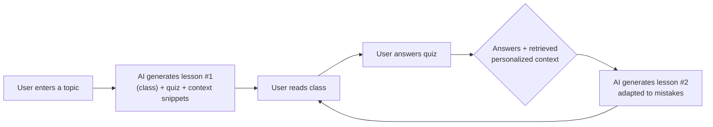
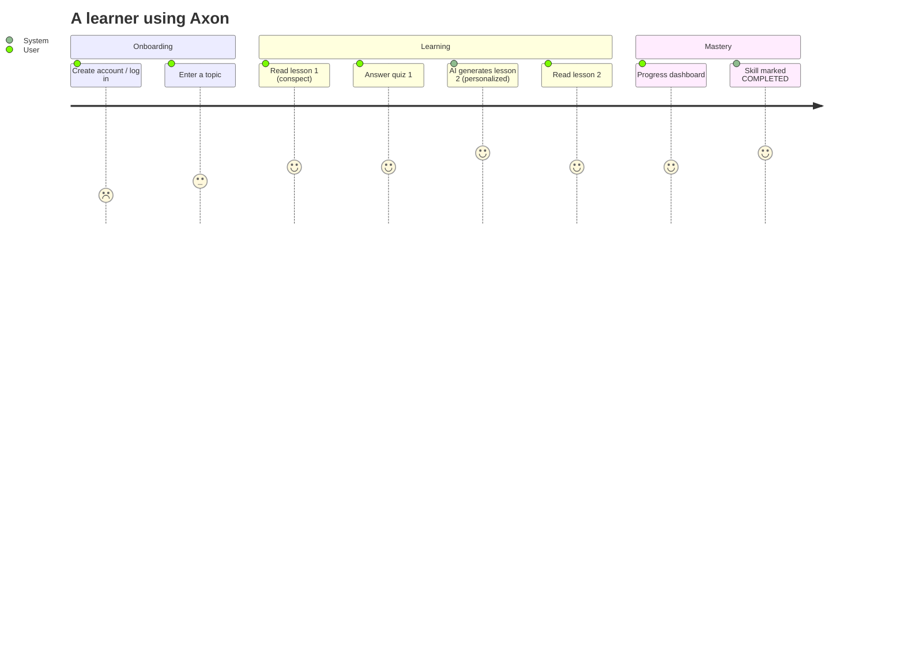

# Axon — Concept & Product Knowledge Base

> Where ARCHITECTURE.md explains the **code as it is**, this document explains the **idea as it was
> meant to be** — the product intent, the mental model, and the vocabulary. It is the shared
> language for humans and AI agents working on Axon. Read this first.

## 1. The product in one line

**Axon turns any topic a person types in into an adaptive, AI-tutored learning journey made of
sequential lessons, quizzes, and a growing per-user memory of what they know and get wrong.**

## 2. The core loop (the whole point of the product)



This is a **closed adaptive loop**: the system learns from every answer and every known-about-the-
user fact, and uses that to make the *next* lesson personally relevant.

### The three "smarts" that make Axon different:
1. **Sequential lessons ("classes"), not a flat dump.** Content is broken into index-ordered
   `Class` rows (`@@unique([skillId, index])`).
2. **Per-user context memory.** The AI stores short `contextSnippets` ("the user is a backend dev
   who likes Golang", "user already knows SQL joins") as embeddings in a `Vector` store. The intent
   (`VectorSource.AI_NEXT`, `ANSWER_DERIVED`) is to pull these back during generation so lesson #N+1
   is tailored.
3. **Answer-aware adaptation.** Quiz answers (score, correctness, time spent) feed the next
   generation, so the tutor re-explains weak areas.

## 3. Vocabulary (how to talk about Axon)

| Term | Meaning | Where it lives |
|---|---|---|
| **Skill** | A user's entire learning journey on one topic (their "course"). Has a status lifecycle. | `Skill` model |
| **Class** | One ordered lesson inside a skill. Markdown body + index. | `Class` model |
| **Quiz** | The set of questions attached to a class. | `Question` rows under a `classId` |
| **Question** | MC / True-False / Open-ended; has choices + `answerKey`. | `Question` model |
| **Answer** | A user's recorded attempt at a question (content, score, correctness, time). | `Answer` model |
| **Context snippet** | A short atomic fact about the user stored for personalization. | `Vector` (source `AI_INITIAL/NEXT/ANSWER_DERIVED`) + `textSnippet` |
| **Vector** | A `pgvector` embedding of a snippet, or of derived answer content. | `Vector` model (`vector(3072)`) |
| **Adaptive loop** | Read → quiz → (retrieve context + score) → generate next class. | **NOT YET WIRED** |
| **lambda (0.02)** | Suggested decay rate for the relevance of stored context over time (memory half-life). | `Skill.lambda` — **unused** |
| **Event log** | Lightweight audit trail of key moments (skill created, class generated, answer submitted...). | `Event` model |

## 4. Domain model in plain English

```
User
 └─ owns many Skills            (a User is a learner)
 Skill
 └─ has ordered Classes         (lesson 0, lesson 1, …)
 └─ has Questions / Answers     (assessments)
 └─ has a SkillProgress         (one row snapshot per skill)
 └─ has Vectors                 (the user's knowledge memory for this topic)
 └─ emits Events                (audit)
 Class
 └─ has contentMd (the lesson)
 └─ has Questions
 └─ embeds Vectors (its source snippets)
 Question
 └─ type (MC / TF / Open)
 └─ choices + answerKey
 └─ collects Answers
 Answer
 └─ belongs to a Question, a User, and a Skill
 └─ may derive new Vectors (from the answer content)
```

## 5. The "memory" idea (the strategic differentiator)

The `Vector` model is the heart of the concept, and currently the most under-built:

- **What it is:** a vectorized store of *small, self-contained facts* about a user's learning
  context, sourced from:
  - `AI_INITIAL` — facts the model extracted when first creating the skill.
  - `AI_NEXT` — facts learned as new classes are generated **[PLANNED]**.
  - `ANSWER_DERIVED` — facts mined from a user's answers **[PLANNED]**.
- **The intent:** instead of dumping the user's whole history into every prompt, the system
  *retrieves only the most relevant vectors* (semantic search over `pgvector`), and feeds them to
  Gemini so the next class is personalized and doesn't repeat known material.
- **`Skill.lambda`** exists to let older memories "decay" so stale context doesn't dominate — a
  recall/relevance weight. Unused today.

**Status:** vectors are written during skill creation but **never read**. The memory doesn't
influence anything yet. This is the single most valuable missing piece.

## 6. User journey map (desired)



## 7. Current reality vs. vision (honest gap table)

| Product vision | Code today |
|---|---|
| User signs up / logs in | Hard-coded user id 1, no auth |
| User picks a topic and it builds a course | `skill.create` works, but there is **no entry point in the UI** |
| Read a lesson | ✅ Works (class conspect renders Markdown) |
| Answer a quiz | Partial: quiz renders; **submit does nothing** |
| System adapts next lesson | **Not implemented** (`generateNextClass` commented out) |
| Personalized memory influences content | Vectors written, **never retrieved** |
| Progress tracking | `SkillProgress` table exists, **unused** |
| Status lifecycle | Stuck at `DRAFT`; nothing transitions it |

## 8. Non-goals / scope boundaries (for AI agents)

- **Do not** add unrelated features while closing the adaptive loop. The loop is the product.
- **Do not** build multi-tenant auth complexity for beta — a single real account or minimal email
  auth is enough to prove the loop.
- **Do not** chase OpenSearch/AWS — vector storage is already Postgres `pgvector`; remove the
  dead OpenSearch config rather than wiring it.
- **Do not** over-engineer `lambda`/decay until retrieval exists and there's data to tune against.

## 9. Design intentions worth preserving

- **Contract-first oRPC:** the shared contract is the single source of truth for the API. Keep
  adding endpoints to `packages/api-contract`, implement via `rpc.*.handler`.
- **`contextSnippets` as atomic facts:** keep snippets small, self-contained, and fact-like (they
  get embedded and retrieved individually). This is what makes retrieval work well.
- **Push real work off the request path:** `runDetached` is the right instinct for slow AI gen,
  but it must become observable (status/progress channel), not fire-and-forget.
