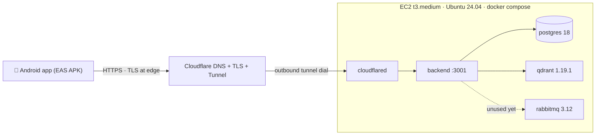

# Axon — AWS beta deployment (single EC2 host + Cloudflare Tunnel)

> Written 2026-09-22. **Execution authority for deploying the beta to AWS.** The user
> performs the console steps (AWS, Cloudflare, Firebase, Expo); everything scriptable is
> already in the repo: `docker-compose-prod.yaml` (full stack), `.env.aws.example`
> (config template), `apps/mobile/eas.json` (Android beta build). Deployment stack:
> Postgres + Qdrant + RabbitMQ + backend on one EC2 instance, published outbound via a
> Cloudflare Tunnel — **no inbound ports except SSH**. Beta history:
> `BETA_PLAN.md`; post-beta backlog: `PHASE7_POST_BETA.md`.

## 0. Topology & decisions



| Decision | Choice | Why |
|---|---|---|
| Hosting shape | One EC2 instance, all services in docker compose | Beta = 1 user; managed PG/Qdrant would cost 10× for zero benefit |
| Instance | `t3.medium` (4 GB, ~$30/mo) + 25 GB gp3 | Docker build of the workspace peaks ~2 GB; t3.small needs a swapfile (§8) |
| Ingress | Cloudflare Tunnel (`cloudflared` in compose) | TLS at CF edge, zero open inbound ports, IP changes don't matter; needs a domain on Cloudflare (free plan) |
| RabbitMQ | Deployed **per user decision** | Zero code references today (no amqplib) — reserved capacity for future durable-jobs work; supersedes Phase 7 S6 "delete rabbitmq" |
| Android build | EAS cloud build, `preview` profile → installable APK | No Android SDK needed locally; free Expo account |
| App → API | `EXPO_PUBLIC_API_URL=https://axon.<domain>` baked at build time | `apps/mobile/utils/rpc.ts` honors it; Android `usesCleartextTraffic` already enabled (fallback §9 needs no app change) |
| Cost | ~$30–35/mo total (EC2 + EBS) | Cloudflare plan/tunnel, EAS free tier, Firebase Spark: $0 |

Request path note: Cloudflare's free proxy timeout is 100 s — safe, because
lesson generation is asynchronous (`NextClassJob` queue): submit/init return
immediately, generation completes in the background.

## 1. Prerequisites (one-time)

1. AWS account with billing enabled.
2. A **domain** (any registrar, ~$10/yr — or one you already own). Cloudflare requires
   one; there is no way around it for the Tunnel path.
3. API keys: `ZAI_API_KEY` (z.ai, chat) and `GEMINI_API_KEY` (Google AI Studio,
   embeddings) — same ones used in local dev.
4. Firebase project — the existing one. You need its **Web app** config
   (Project settings → General → Your apps → Web app): `apiKey`, `authDomain`,
   `projectId`, `appId`.
5. Expo account (free) — `eas login`.
6. Android phone (8+) for install.

## 2. Cloudflare: DNS + Tunnel (console only, ~15 min)

1. dash.cloudflare.com → **Add a domain** → follow the wizard → at your registrar,
   replace nameservers with the two Cloudflare ones → wait for "Active" (minutes–hours).
2. Zero Trust dashboard (one.cloudflare.com) → **Networks → Tunnels → Create a tunnel**
   → connector type **Cloudflared** → name `axon-beta` → **copy the tunnel token**
   (this is `CF_TUNNEL_TOKEN`).
3. In the same tunnel → **Public hostname** → add:
   - subdomain `axon`, domain `<yours>`, path empty
   - service: **HTTP**, URL **`backend:3001`** ← exact string: `backend` is the compose
     service name; cloudflared resolves it over the shared docker network.

Gate: you have `CF_TUNNEL_TOKEN` saved. The hostname 522/1033-errors until step 6 — expected.

## 3. AWS: EC2 instance (console, ~10 min)

1. EC2 → Launch instance:
   - name `axon-beta`; AMI **Ubuntu Server 24.04 LTS** (amd64); type **t3.medium**
   - key pair: create `axon-beta` (ed25519), download the `.pem`, `chmod 400` it
   - storage: **25 GiB gp3**
   - security group: create `axon-beta-sg` with **one inbound rule: SSH (22) from My IP**.
     Nothing else — the tunnel is outbound-only; DB/Qdrant/RabbitMQ never leave the host.
2. Recommended: **Elastic IP** → allocate → associate (stable IP across stop/start;
   the tunnel doesn't care, SSH convenience does).
3. (Optional hardening) EC2 → the instance → connect via Session Manager works without
   port 22 at all, if you later close SSH entirely.

Gate: `ssh -i axon-beta.pem ubuntu@<ip>` succeeds.

## 4. Server bootstrap (~5 min)

```bash
sudo apt update && sudo apt install -y docker.io docker-compose-v2
sudo usermod -aG docker ubuntu && sudo systemctl enable --now docker
# log out/in for the docker group, then:
docker compose version    # gate: prints v2.x
```

Get the code onto the box — from your dev machine, in the repo root:

```bash
rsync -a --exclude node_modules --exclude .git --exclude .expo \
  --exclude apps/mobile/android --exclude apps/mobile/ios \
  ./ ubuntu@<ip>:~/axon/
```

(or `git clone` with a personal access token if the repo is pushed to a remote).

## 5. Configure secrets (~5 min, on the server)

```bash
cd ~/axon
cp .env.aws.example .env.aws
openssl rand -base64 24   # → POSTGRES_PASSWORD
openssl rand -base64 24   # → RABBITMQ_PASSWORD
nano .env.aws             # fill every value; DATABASE_URL must embed the same
                          # POSTGRES_PASSWORD: postgresql://axon:<pw>@db:5432/axon
chmod 600 .env.aws
```

## 6. Launch & verify (~10 min, first build)

```bash
docker compose --env-file .env.aws -f docker-compose-prod.yaml up -d --build
docker compose --env-file .env.aws -f docker-compose-prod.yaml ps      # gate: backend (healthy)
curl -s http://127.0.0.1:3001/health                                   # gate: {"status":"ok",...}
docker compose --env-file .env.aws -f docker-compose-prod.yaml logs -f backend
# watch: "prisma migrate deploy" success → "Server listening" → "Health check"
```

Then from anywhere (phone browser): **`https://axon.<domain>/health`** → same JSON, and
**`https://axon.<domain>/`** → the RPC docs page. That proves edge-TLS → tunnel →
backend end-to-end. (`pnpm backend:start` runs the same command from the repo root.)

## 7. Android beta via EAS (~30 min incl. queue)

1. Fill **both** profiles' `env` in `apps/mobile/eas.json`:
   - `EXPO_PUBLIC_API_URL=https://axon.<domain>`
   - Firebase Web-app values (`EXPO_PUBLIC_FIREBASE_*`) from Firebase console.
   - `EXPO_PUBLIC_FIREBASE_WEB_CLIENT_ID` stays empty for beta — Google sign-in needs
     the Android app registered in Firebase + SHA-1 (see
     `apps/mobile/FIREBASE_SETUP.md`); **email/password auth is enough for beta**.
2. From the repo root: `npm i -g eas-cli && eas login`
3. `cd apps/mobile && eas build -p android --profile preview`
   → EAS builds an **APK** in the cloud (~10–20 min queue) and prints an install link.
4. On the phone: open the link → allow "install unknown apps" → install → open Axon.
5. **End-to-end smoke (gate):** sign up (email/password) → create a skill → watch
   GENERATING → lesson renders → answer the quiz → submit → results → the *next class
   appears* (proves the remote `NextClassJob` queue + AI keys work). Do it once on
   mobile data, not WiFi, to exercise the real network path.

## 8. Runbook

| Task | Command |
|---|---|
| Deploy an update | `git pull` (or re-rsync) then `docker compose --env-file .env.aws -f docker-compose-prod.yaml up -d --build` — migrations apply automatically at container start |
| Logs | `docker compose --env-file .env.aws -f docker-compose-prod.yaml logs -f backend` (or `db`, `qdrant`, `rabbitmq`, `cloudflared`) |
| DB backup | `docker compose --env-file .env.aws -f docker-compose-prod.yaml exec db pg_dump -U axon -d axon > backup-$(date +%F).sql` — then `scp` it off the box |
| RabbitMQ UI | `ssh -L 15672:127.0.0.1:15672 ubuntu@<ip>` → http://localhost:15672 (creds from `.env.aws`) — informational only |
| Memory check | `free -h` — if on t3.small: `sudo fallocate -l 2G /swapfile && sudo chmod 600 /swapfile && sudo mkswap /swapfile && sudo swapon /swapfile` + fstab line |
| Stop / resume | EC2 Stop / Start instance; `restart: unless-stopped` + enabled docker service bring the stack back on boot |

## 9. Fallback: no domain, plain HTTP (works today, less secure)

Comment out the `cloudflared` service, open inbound TCP **3001** in the SG (or restrict
to your phone's IP), set `EXPO_PUBLIC_API_URL=http://<ec2-ip>:3001`, rebuild the APK.
The Android app already allows cleartext. Risk: Firebase ID tokens (≈1 h validity) and
content transit the network unencrypted — acceptable only for a throwaway beta.

## 10. Security notes & known deviations

- Attack surface: only SSH (restrict to your IP) and the Cloudflare edge. Postgres,
  Qdrant, RabbitMQ are reachable solely on the internal docker network. **Qdrant has no
  authentication — never publish 6333/6334.**
- TLS terminates at Cloudflare; origin traffic rides the encrypted tunnel.
- `.env.aws` never enters git or the docker build (`.dockerignore` excludes `.env*` and
  `apps/mobile`); secrets exist only in the server file and the Cloudflare/EAS dashboards.
- RabbitMQ is deployed by explicit user decision (2026-09-22) although nothing connects
  to it yet; Phase 7 S6's "delete the unused rabbitmq container" is superseded by this
  document. Revisit when S3/S4 job durability work lands.
- Cost control: the whole stack bills as one t3.medium + 25 GB gp3 (~$30–35/mo);
  stop the instance when idle for long stretches.

## 11. After first deploy — check these boxes

- [ ] `https://axon.<domain>/health` returns `{"status":"ok"}` from the phone
- [ ] `docker compose ps` shows backend `healthy`, no restarting containers
- [ ] One full learn loop on the phone (create → generate → quiz → next class)
- [ ] `backup-*.sql` produced once and stored off-box
- [ ] Firebase: Android app `com.axon.app` registered + SHA-1 added (only when Google
      sign-in is wanted)
