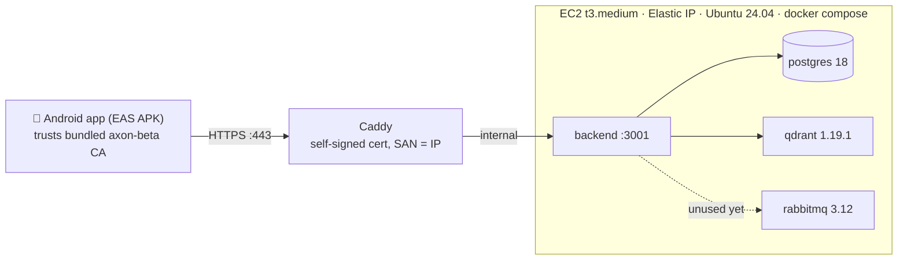

# Axon — AWS beta deployment (static Elastic IP, HTTPS with self-signed CA)

> Written 2026-09-22; revised same day twice: **no domain** — the API is
> `https://<ELASTIC_IP>` with a **self-signed CA generated by us**: Caddy terminates TLS
> on the server with a cert whose SAN is the IP, and the Android app bundles the CA via
> a Network Security Config (`apps/mobile/plugins/withNetworkSecurityConfig.js`).
> **Execution authority for deploying the beta to AWS.** The user performs the console
> steps (AWS, Firebase, Expo); everything scriptable is in the repo. Stack: Postgres +
> Qdrant + RabbitMQ + backend + Caddy on one EC2 instance. Beta history: `BETA_PLAN.md`;
> post-beta backlog: `PHASE7_POST_BETA.md`.

## 0. Topology & decisions



| Decision | Choice | Why |
|---|---|---|
| Hosting shape | One EC2 instance, all services in docker compose | Beta = 1 user; managed PG/Qdrant would cost 10× for zero benefit |
| Instance | `t3.medium` (4 GB, ~$30/mo) + 25 GB gp3 | Docker build of the workspace peaks ~2 GB; t3.small needs a swapfile (§8) |
| TLS | **Self-signed CA (ours) + Caddy**, `tls <cert> <key>` on `:443` | User decision (2026-09-22): no domain, no third parties. Works because the APK bundles the CA (Android NSC) and the cert's SAN is the IP |
| Ingress | `https://<ELASTIC_IP>` (443 only) | Backend stays loopback; SG opens just SSH + 443 |
| Cert lifecycle | 10-year CA + 10-year server cert | No renewals for beta. Regenerate only if the IP changes: rerun the script with `--force`, re-scp, **rebuild APK** (CA would differ) |
| RabbitMQ | Deployed **per user decision** | Zero code references today (no amqplib) — reserved capacity for future durable-jobs work; supersedes Phase 7 S6 "delete rabbitmq" |
| Android build | EAS cloud build, `preview` profile → installable APK | No Android SDK needed locally; free Expo account |
| Cost | ~$35–40/mo total (EC2 + EBS + Elastic IP) | EAS free tier, Firebase Spark: $0 |

**Elastic IP is load-bearing twice**: it is the API address AND the cert's SAN.
Never release it. If it ever changes: `./deploy/generate-certs.sh <NEW_IP> --force`,
re-scp certs, update `eas.json` + `app.json` plugin `ip`, rebuild the APK.

## 1. Prerequisites (one-time)

1. AWS account with billing enabled.
2. API keys: `ZAI_API_KEY` (z.ai, chat) and `GEMINI_API_KEY` (Google AI Studio,
   embeddings) — same ones used in local dev.
3. Firebase project — the existing one. You need its **Web app** config
   (Project settings → General → Your apps → Web app): `apiKey`, `authDomain`,
   `projectId`, `appId`.
4. Expo account (free) — `eas login`.
5. Android phone (8+) for install.
6. `openssl` on your dev machine (any Linux/macOS has it).

No domain needed at any step.

## 2. AWS: EC2 + static IP (console, ~15 min)

1. EC2 → **Network & Security → Elastic IPs → Allocate Elastic IP address** → allocate
   (keep the IP noted; it is your permanent API address AND the cert SAN, e.g. `54.10.20.30`).
2. EC2 → Launch instance:
   - name `axon-beta`; AMI **Ubuntu Server 24.04 LTS** (amd64); type **t3.medium**
   - key pair: create `axon-beta` (ed25519), download the `.pem`, `chmod 400` it
   - storage: **25 GiB gp3**
   - security group: create `axon-beta-sg` with exactly **two inbound rules**:
     - SSH (22) — source **My IP**
     - Custom TCP **443** — source **0.0.0.0/0** (the HTTPS endpoint)
   - nothing else: backend/Postgres/Qdrant/RabbitMQ never leave the host (backend is
     loopback-only; Caddy talks to it over the internal docker network).
3. **Associate the Elastic IP** with the instance.

Gate: `ssh -i axon-beta.pem ubuntu@<ELASTIC_IP>` succeeds.

## 3. Certificates (dev machine, ~2 min)

```bash
cd ~/Projects/axon
./deploy/generate-certs.sh <ELASTIC_IP>
# verifies itself: SAN line shows "IP Address:<ELASTIC_IP>", chain verifies OK
```

This produces:

| File | Where it goes | Secret? |
|---|---|---|
| `deploy/certs/ca.key` | **stays on your dev machine, offline backup** | **YES — never commit, never scp** |
| `deploy/certs/server.crt` + `server.key` | server: `~/axon/deploy/certs/` | key is secret |
| `deploy/certs/axon-ca.crt` → copied to `apps/mobile/ca/axon-ca.crt` | committed to git; bundled into the APK by the config plugin | public |
| `deploy/Caddyfile` | already in repo, mounted read-only by compose | — |

`deploy/certs/` is git-ignored; `apps/mobile/ca/axon-ca.crt` **is** committed so EAS
cloud builds bundle it. Losing `ca.key` only matters if you need to sign a different
cert (e.g. IP change) — regenerate everything with `--force` then.

## 4. Server bootstrap (~5 min)

```bash
sudo apt update && sudo apt install -y docker.io docker-compose-v2
sudo usermod -aG docker ubuntu && sudo systemctl enable --now docker
# log out/in for the docker group, then:
docker compose version    # gate: prints v2.x
```

Get the code onto the box — from your dev machine, in the repo root:

```bash
rsync -a --exclude node_modules --exclude .git --exclude .expo \
  --exclude apps/mobile/android --exclude apps/mobile/ios \
  --exclude deploy/certs \
  ./ ubuntu@<ELASTIC_IP>:~/axon/
scp deploy/certs/server.crt deploy/certs/server.key deploy/certs/axon-ca.crt \
  ubuntu@<ELASTIC_IP>:~/axon/deploy/certs/
```

(`deploy/certs` is excluded from rsync so `ca.key` never leaves this machine; the three
public/operational files go by scp. If you `git clone` instead, the `scp` is mandatory.)

## 5. Configure secrets (~5 min, on the server)

```bash
cd ~/axon
cp .env.aws.example .env.aws
openssl rand -base64 24   # → POSTGRES_PASSWORD
openssl rand -base64 24   # → RABBITMQ_PASSWORD
nano .env.aws             # fill every value; DATABASE_URL must embed the same
                          # POSTGRES_PASSWORD: postgresql://axon:<pw>@db:5432/axon
chmod 600 .env.aws
```

## 6. Launch & verify (~10 min, first build)

```bash
docker compose --env-file .env.aws -f docker-compose-prod.yaml up -d --build
docker compose --env-file .env.aws -f docker-compose-prod.yaml ps      # gate: backend (healthy), caddy running
curl -sk https://127.0.0.1/health -H "Host: <ELASTIC_IP>"              # quick local check
```

Then the real gate, from your dev machine:

```bash
curl --cacert deploy/certs/axon-ca.crt https://<ELASTIC_IP>/health
# → {"status":"ok",...}  — proves cert chain + IP SAN + Caddy + backend
```

`curl` verifies exactly what the phone will (chain to the bundled CA + IP SAN). Same
URL in any browser shows a warning only because the CA isn't a public one — expected.

## 7. Android beta via EAS (~30 min incl. queue)

1. Replace `REPLACE-WITH-STATIC-IP` in **both** places:
   - `apps/mobile/eas.json` `env`: `EXPO_PUBLIC_API_URL=https://<ELASTIC_IP>` (both profiles)
   - `apps/mobile/app.json` plugins: `withNetworkSecurityConfig` → `{ "ip": "<ELASTIC_IP>" }`
2. Fill the `EXPO_PUBLIC_FIREBASE_*` values from Firebase console (Web app config).
   `EXPO_PUBLIC_FIREBASE_WEB_CLIENT_ID` stays empty for beta — Google sign-in needs the
   Android app registered + SHA-1 (`apps/mobile/FIREBASE_SETUP.md`); **email/password
   auth is enough for beta**.
3. Commit `apps/mobile/ca/axon-ca.crt` + these edits, then from the repo root:
   `npm i -g eas-cli && eas login`
4. `cd apps/mobile && eas build -p android --profile preview`
   → EAS builds an **APK** in the cloud (~10–20 min queue) and prints an install link.
5. On the phone: open the link → allow "install unknown apps" → install → open Axon.
6. **End-to-end smoke (gate):** sign up (email/password) → create a skill → watch
   GENERATING → lesson renders → answer the quiz → submit → results → the *next class
   appears*. (Phone trusts the server because the APK bundles the CA; the cert's SAN
   matches the IP.)

## 8. Runbook

| Task | Command |
|---|---|
| Deploy an update | `git pull` (or re-rsync + scp certs once) then `docker compose --env-file .env.aws -f docker-compose-prod.yaml up -d --build` — migrations apply automatically at container start |
| Logs | `docker compose --env-file .env.aws -f docker-compose-prod.yaml logs -f backend` (or `caddy`, `db`, `qdrant`, `rabbitmq`) |
| DB backup | `docker compose --env-file .env.aws -f docker-compose-prod.yaml exec db pg_dump -U axon -d axon > backup-$(date +%F).sql` — then `scp` it off the box |
| RabbitMQ UI | `ssh -L 15672:127.0.0.1:15672 ubuntu@<ELASTIC_IP>` → http://localhost:15672 (creds from `.env.aws`) — informational only |
| Memory check | `free -h` — if on t3.small: `sudo fallocate -l 2G /swapfile && sudo chmod 600 /swapfile && sudo mkswap /swapfile && sudo swapon /swapfile` + fstab line |
| Stop / resume | EC2 Stop / Start; **the Elastic IP survives stop/start**; `restart: unless-stopped` + enabled docker bring the stack back on boot |
| IP changed anyway | `./deploy/generate-certs.sh <NEW_IP> --force` → scp certs → update `eas.json` + `app.json` → rebuild APK |

## 9. Security notes & known deviations

- Attack surface: SSH (your IP) + 443. Backend is loopback-only; Postgres, Qdrant,
  RabbitMQ live on the internal docker network only. **Qdrant has no authentication —
  never publish 6333/6334.**
- TLS is real encryption but with a **private CA**: anyone holding `deploy/certs/ca.key`
  could impersonate your server — that file stays on your dev machine, never committed,
  never on the server. Strangers cannot get a cert for your IP from anywhere else.
- The bundled CA lets the APK trust *your* server only for the configured IP
  (`domain-config`); system CAs remain trusted everywhere else.
- `ca.key` has no expiry pressure (10 y). When beta ends or the IP changes, regenerate
  the whole chain with `--force` and ship one APK update.
- `.env.aws` and `deploy/certs/` never enter git (`.gitignore`) nor the docker build
  (`.dockerignore` excludes `.env*`, `apps/mobile`).
- RabbitMQ is deployed by explicit user decision (2026-09-22) although nothing connects
  to it yet; Phase 7 S6's "delete the unused rabbitmq container" is superseded by this
  document. Revisit when S3/S4 job durability work lands.
- Cost: t3.medium + 25 GB gp3 + Elastic IP (~$35–40/mo); stop the instance when idle.

## 10. After first deploy — check these boxes

- [ ] `./deploy/generate-certs.sh <ELASTIC_IP>` run; chain verified OK
- [ ] `curl --cacert deploy/certs/axon-ca.crt https://<ELASTIC_IP>/health` → `{"status":"ok"}`
- [ ] `docker compose ps`: backend `healthy`, caddy running, nothing restarting
- [ ] One full learn loop on the phone (create → generate → quiz → next class)
- [ ] `backup-*.sql` produced once and stored off-box
- [ ] `apps/mobile/ca/axon-ca.crt` committed; `deploy/certs/ca.key` backed up offline
- [ ] Firebase: Android app `com.axon.app` registered + SHA-1 (only when Google
      sign-in is wanted)
