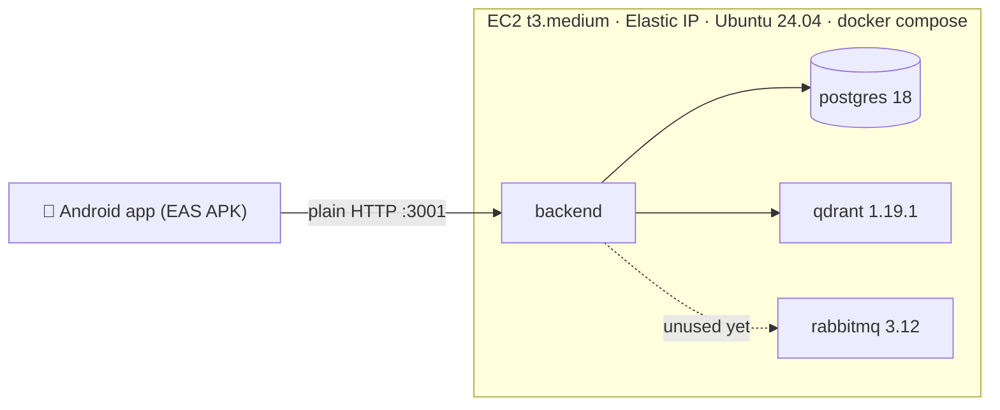

# Axon — AWS beta deployment (single EC2 host on a static Elastic IP)

> Written 2026-09-22; **revised same day: no domain, no Cloudflare** — the app talks
> plain HTTP to the server's static Elastic IP (`http://<IP>:3001`). **Execution
> authority for deploying the beta to AWS.** The user performs the console steps
> (AWS, Firebase, Expo); everything scriptable is in the repo: `docker-compose-prod.yaml`
> (full stack), `.env.aws.example` (config template), `apps/mobile/eas.json` (Android
> beta build). Stack: Postgres + Qdrant + RabbitMQ + backend on one EC2 instance.
> Beta history: `BETA_PLAN.md`; post-beta backlog: `PHASE7_POST_BETA.md`.

## 0. Topology & decisions



| Decision | Choice | Why |
|---|---|---|
| Hosting shape | One EC2 instance, all services in docker compose | Beta = 1 user; managed PG/Qdrant would cost 10× for zero benefit |
| Instance | `t3.medium` (4 GB, ~$30/mo) + 25 GB gp3 | Docker build of the workspace peaks ~2 GB; t3.small needs a swapfile (§8) |
| Ingress | **Static Elastic IP, plain HTTP on port 3001** | User decision (2026-09-22): no domain purchase. Android cleartext already enabled in `app.json`; `EXPO_PUBLIC_API_URL` is baked into the APK at build time |
| Elastic IP cost | ~$3.65/mo (all public IPv4 bill since Feb 2024) | Never RELEASE the Elastic IP — a new allocation means a new IP and an APK rebuild |
| RabbitMQ | Deployed **per user decision** | Zero code references today (no amqplib) — reserved capacity for future durable-jobs work; supersedes Phase 7 S6 "delete rabbitmq" |
| Android build | EAS cloud build, `preview` profile → installable APK | No Android SDK needed locally; free Expo account |
| Cost | ~$35–40/mo total (EC2 + EBS + Elastic IP) | EAS free tier, Firebase Spark: $0 |

Accepted risk (beta): traffic is **unencrypted** — Firebase ID tokens (≈1 h validity)
and lesson content transit the network in cleartext. Fine for personal testing; revisit
TLS before any real users (options then: domain + Caddy, or Cloudflare Tunnel).

## 1. Prerequisites (one-time)

1. AWS account with billing enabled.
2. API keys: `ZAI_API_KEY` (z.ai, chat) and `GEMINI_API_KEY` (Google AI Studio,
   embeddings) — same ones used in local dev.
3. Firebase project — the existing one. You need its **Web app** config
   (Project settings → General → Your apps → Web app): `apiKey`, `authDomain`,
   `projectId`, `appId`.
4. Expo account (free) — `eas login`.
5. Android phone (8+) for install.

No domain needed at any step.

## 2. AWS: EC2 + static IP (console, ~15 min)

1. EC2 → **Network & Security → Elastic IPs → Allocate Elastic IP address** → allocate
   (keep the IP noted; this is your permanent API address, e.g. `54.10.20.30`).
2. EC2 → Launch instance:
   - name `axon-beta`; AMI **Ubuntu Server 24.04 LTS** (amd64); type **t3.medium**
   - key pair: create `axon-beta` (ed25519), download the `.pem`, `chmod 400` it
   - storage: **25 GiB gp3**
   - security group: create `axon-beta-sg` with exactly **two inbound rules**:
     - SSH (22) — source **My IP**
     - Custom TCP **3001** — source **0.0.0.0/0** (the app endpoint)
   - nothing else: Postgres/Qdrant/RabbitMQ never leave the host.
3. **Associate the Elastic IP** with the new instance (Elastic IPs → Actions →
   Associate → instance `axon-beta`).
4. Optional hardening later: AWS Systems Manager Session Manager gives shell access
   with port 22 closed entirely.

Gate: `ssh -i axon-beta.pem ubuntu@<ELASTIC_IP>` succeeds.

## 3. Server bootstrap (~5 min)

```bash
sudo apt update && sudo apt install -y docker.io docker-compose-v2
sudo usermod -aG docker ubuntu && sudo systemctl enable --now docker
# log out/in for the docker group, then:
docker compose version    # gate: prints v2.x
```

Get the code onto the box — from your dev machine, in the repo root:

```bash
rsync -a --exclude node_modules --exclude .git --exclude .expo \
  --exclude apps/mobile/android --exclude apps/mobile/ios \
  ./ ubuntu@<ELASTIC_IP>:~/axon/
```

(or `git clone` with a personal access token if the repo is pushed to a remote).

## 4. Configure secrets (~5 min, on the server)

```bash
cd ~/axon
cp .env.aws.example .env.aws
openssl rand -base64 24   # → POSTGRES_PASSWORD
openssl rand -base64 24   # → RABBITMQ_PASSWORD
nano .env.aws             # fill every value; DATABASE_URL must embed the same
                          # POSTGRES_PASSWORD: postgresql://axon:<pw>@db:5432/axon
chmod 600 .env.aws
```

## 5. Launch & verify (~10 min, first build)

```bash
docker compose --env-file .env.aws -f docker-compose-prod.yaml up -d --build
docker compose --env-file .env.aws -f docker-compose-prod.yaml ps      # gate: backend (healthy)
curl -s http://127.0.0.1:3001/health                                   # gate: {"status":"ok",...}
docker compose --env-file .env.aws -f docker-compose-prod.yaml logs -f backend
# watch: "prisma migrate deploy" success → "Server listening" → "Health check"
```

Then from your phone's browser (mobile data, not WiFi):
**`http://<ELASTIC_IP>:3001/health`** → same JSON — proves the security group, port
publish, and server all line up. (`pnpm backend:start` runs the same compose command.)

## 6. Android beta via EAS (~30 min incl. queue)

1. Fill **both** profiles' `env` in `apps/mobile/eas.json`:
   - `EXPO_PUBLIC_API_URL=http://<ELASTIC_IP>:3001` ← the static IP from §2
   - Firebase Web-app values (`EXPO_PUBLIC_FIREBASE_*`) from Firebase console.
   - `EXPO_PUBLIC_FIREBASE_WEB_CLIENT_ID` stays empty for beta — Google sign-in needs
     the Android app registered in Firebase + SHA-1 (see
     `apps/mobile/FIREBASE_SETUP.md`); **email/password auth is enough for beta**.
2. From the repo root: `npm i -g eas-cli && eas login`
3. `cd apps/mobile && eas build -p android --profile preview`
   → EAS builds an **APK** in the cloud (~10–20 min queue) and prints an install link.
4. On the phone: open the link → allow "install unknown apps" → install → open Axon.
5. **End-to-end smoke (gate):** sign up (email/password) → create a skill → watch
   GENERATING → lesson renders → answer the quiz → submit → results → the *next class
   appears* (proves the remote `NextClassJob` queue + AI keys work).

## 7. Runbook

| Task | Command |
|---|---|
| Deploy an update | `git pull` (or re-rsync) then `docker compose --env-file .env.aws -f docker-compose-prod.yaml up -d --build` — migrations apply automatically at container start |
| Logs | `docker compose --env-file .env.aws -f docker-compose-prod.yaml logs -f backend` (or `db`, `qdrant`, `rabbitmq`) |
| DB backup | `docker compose --env-file .env.aws -f docker-compose-prod.yaml exec db pg_dump -U axon -d axon > backup-$(date +%F).sql` — then `scp` it off the box |
| RabbitMQ UI | `ssh -L 15672:127.0.0.1:15672 ubuntu@<ELASTIC_IP>` → http://localhost:15672 (creds from `.env.aws`) — informational only |
| Memory check | `free -h` — if on t3.small: `sudo fallocate -l 2G /swapfile && sudo chmod 600 /swapfile && sudo mkswap /swapfile && sudo swapon /swapfile` + fstab line |
| Stop / resume | EC2 Stop / Start instance; **the Elastic IP survives stop/start** (only termination/release loses it); `restart: unless-stopped` + enabled docker service bring the stack back on boot |
| IP changed anyway? | Only if you released the EIP or moved regions: update `EXPO_PUBLIC_API_URL` in `eas.json` and rebuild the APK (§6) |

## 8. Security notes & known deviations

- Attack surface: SSH (restrict to your IP) and TCP 3001. Postgres, Qdrant, RabbitMQ
  are reachable solely on the internal docker network. **Qdrant has no authentication —
  never publish 6333/6334.**
- **No TLS (accepted for beta):** tokens and content are visible to a network observer.
  Tokens expire hourly; use a unique password for this Firebase account. Before public
  beta: add a domain + Caddy, or Cloudflare Tunnel (see git history of this file).
- `.env.aws` never enters git or the docker build (`.dockerignore` excludes `.env*` and
  `apps/mobile`); secrets exist only in the server file and the EAS/Firebase consoles.
- RabbitMQ is deployed by explicit user decision (2026-09-22) although nothing connects
  to it yet; Phase 7 S6's "delete the unused rabbitmq container" is superseded by this
  document. Revisit when S3/S4 job durability work lands.
- Cost control: t3.medium + 25 GB gp3 + Elastic IP (~$35–40/mo); stop the instance when
  idle for long stretches.

## 9. After first deploy — check these boxes

- [ ] `http://<ELASTIC_IP>:3001/health` returns `{"status":"ok"}` from the phone
- [ ] `docker compose ps` shows backend `healthy`, no restarting containers
- [ ] One full learn loop on the phone (create → generate → quiz → next class)
- [ ] `backup-*.sql` produced once and stored off-box
- [ ] Firebase: Android app `com.axon.app` registered + SHA-1 added (only when Google
      sign-in is wanted)
