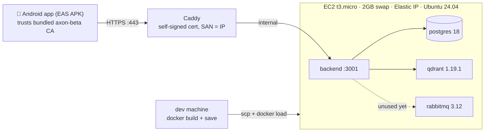

# Axon — AWS beta deployment (free tier, ≤5 users, HTTPS with self-signed CA)

> Written 2026-09-22; free-tier edition (≤5 users). **No domain** — the API is
> `https://<ELASTIC_IP>` with a **self-signed CA generated by us**: Caddy terminates TLS
> with a cert whose SAN is the IP; the Android app bundles the CA via a Network Security
> Config. The **Docker image is built on the dev machine and shipped to the server** —
> the free-tier instance is too small to compile anything. **Execution authority for
> deploying the beta to AWS**; the user performs console steps, everything scriptable is
> in the repo. Stack: Postgres + Qdrant + RabbitMQ + backend + Caddy on one EC2 instance.

## 0. Topology, sizing & real costs



| Decision | Choice | Why |
|---|---|---|
| Instance | **t3.micro** (1 vCPU, 1 GiB) + **2 GB swapfile** | Free tier (750 h/mo, first 12 months). Enough for ≤5 users at runtime; NOT enough to compile the workspace — hence the image-shipping flow |
| Image builds | **On the dev machine** (`pnpm backend:image`), shipped via `docker save` → scp → `docker load` | A workspace build peaks ~2 GB RAM — instant OOM on 1 GiB. **Never run `up -d --build` on the server.** |
| Storage | 25 GiB gp3 | Free tier covers 30 GiB |
| Ingress | `https://<ELASTIC_IP>` (443), Caddy + self-signed CA | User decision: no domain, no third parties; APK bundles the CA |
| Elastic IP | Keep forever | It is the API address AND the cert SAN. Free for 12 months on new accounts (750 h/mo public IPv4); ~$3.65/mo after |
| RabbitMQ | Deployed per user decision | ~100 MB idle for zero function — first candidate to drop if RAM gets tight (delete the `rabbitmq:` block + volume; backend never used it) |
| Android build | EAS cloud build (`preview` → APK) | EAS free plan; no local Android SDK |
| **Cost** | **$0/mo for the first 12 months** on an AWS account younger than 12 months (750 h t3.micro + 750 h public IPv4 + 30 GiB EBS + 100 GB egress). After month 12: ≈ **$13/mo** (micro $7.5 + IPv4 $3.65 + EBS $2) | Free tier is a 12-month program, not forever. Set the billing alarm in §2.5 |
| Firebase / EAS / Cloudflare | $0 (Spark plan / free build plan / unused) | — |

5-user runtime reality: postgres ~100 MB + qdrant ~200 MB + rabbitmq ~100 MB + node
~150 MB + caddy ~20 MB ≈ **600 MB resident** — fits 1 GiB with swap headroom, because
the AI generation work happens on z.ai/Google's servers, not here.

## 1. Prerequisites (one-time)

1. AWS account (younger than 12 months = everything in this plan is $0).
2. `ZAI_API_KEY` (z.ai, chat) and `GEMINI_API_KEY` (Google AI Studio, embeddings) —
   same ones as local dev.
3. Firebase project Web-app config: console.firebase.google.com → your project →
   ⚙ **Project settings → General → Your apps → Web app (`</>`) → Config** → copy
   `apiKey`, `authDomain`, `projectId`, `appId`. Check **Authentication → Sign-in
   method → Email/Password = Enabled**.
4. Expo account (free) — expo.dev.
5. Android phone (8+). `openssl` on the dev machine (preinstalled on Linux/macOS).

No domain needed at any step.

## 2. AWS: static IP + instance (console, ~15 min)

**2.1 — Reserve the IP first** (it's the API address AND the cert SAN):

1. https://console.aws.amazon.com → top-bar region picker → choose a region near you
   (remember it).
2. Search `EC2` → left sidebar **Network & Security → Elastic IPs** → **Allocate Elastic
   IP address** → **Allocate** → **Close**.
3. Copy the IP from the list into your notes — this is `<IP>` everywhere below.

**2.2 — Launch the instance:**

1. Left sidebar **Instances → Launch instances**.
2. Name: `axon-beta`.
3. **Application and OS Images**: **Ubuntu** → **Ubuntu Server 24.04 LTS**, 64-bit (x86).
4. **Instance type**: **t3.micro** (1 vCPU, 1 GiB). If your region has no t3.micro,
   pick **t2.micro** (also free-tier; same commands).
5. **Key pair (login)**: **Create new key pair** → name `axon-beta` → Ed25519, `.pem` →
   **Create key pair** → file downloads → on your machine:
   `chmod 400 ~/Downloads/axon-beta.pem`
6. **Network settings → Edit**: security group **Create new**, name `axon-beta-sg`,
   exactly two inbound rules:
   - **SSH** / port 22 / source **My IP**
   - **Custom TCP** / port **443** / source **Anywhere-IPv4**
7. **Configure storage**: **25 GiB** gp3 (inside the free 30 GiB).
8. **Launch instance** → wait for **Running** + **2/2 checks passed**.

**2.3 — Attach the IP:** Elastic IPs → tick your IP → **Actions → Associate Elastic IP
address** → Resource type **Instance** → select `axon-beta` → **Associate**.

**2.4 — Never release this Elastic IP** (Elastic IPs page). It survives stop/start;
releasing it changes the IP → new certs + new APK.

**2.5 — Cost guardrail:** console top-right account menu → **Billing and Cost
Management → Budgets → Create budget** → "Zero spend budget" (or $5/month) with your
email — free, emails you if anything ever bills.

✓ Gate: `ssh -i ~/Downloads/axon-beta.pem ubuntu@<IP>` greets you with Ubuntu.

## 3. Server bootstrap (5 min, one time)

SSH in, paste:

```bash
sudo apt update && sudo apt install -y docker.io docker-compose-v2

# Mandatory on 1 GiB RAM: 2 GB swap so services never OOM
sudo fallocate -l 2G /swapfile && sudo chmod 600 /swapfile
sudo mkswap /swapfile && sudo swapon /swapfile
echo '/swapfile none swap sw 0 0' | sudo tee -a /etc/fstab

sudo usermod -aG docker ubuntu && sudo systemctl enable --now docker
exit
```

SSH back in (the exit applied the docker group), then `docker compose version` →
✓ prints v2.x; `free -h` → ✓ shows ~2 GiB swap.

## 4. Certificates (dev machine, 2 min)

```bash
cd ~/Projects/axon
./deploy/generate-certs.sh <IP>
```

✓ Self-verifies: SAN line = `IP Address:<IP>`, chain = `server.crt: OK`.

- `deploy/certs/ca.key` → **master secret. Stays on this machine, offline backup.
  Never commit (`deploy/certs/` is git-ignored), never scp.**
- `apps/mobile/ca/axon-ca.crt` → **commit it** (public; the APK bundles it):
  `git add apps/mobile/ca/axon-ca.crt && git commit -m "Add beta CA"`

## 5. Build the image here, ship it over (~10 min, every deploy)

On the **dev machine**:

```bash
pnpm backend:image            # = docker build --target production -t axon-backend:local .
docker save axon-backend:local | gzip > /tmp/axon-backend.tar.gz
scp /tmp/axon-backend.tar.gz ubuntu@<IP>:~/
scp deploy/certs/server.crt deploy/certs/server.key deploy/certs/axon-ca.crt \
  ubuntu@<IP>:~/axon-deploy-certs-tmp/   # first time: ssh ubuntu@<IP> 'mkdir -p ~/axon/deploy/certs' first
```

On the **server**:

```bash
gunzip -c ~/axon-backend.tar.gz | docker load     # ✓ prints "Loaded image: axon-backend:local"
rm ~/axon-backend.tar.gz
```

Then get the code itself (compose file, Caddyfile, prisma migrations, contract) — from
your machine:

```bash
rsync -a --exclude node_modules --exclude .git --exclude .expo \
  --exclude apps/mobile/android --exclude apps/mobile/ios \
  --exclude deploy/certs \
  ./ ubuntu@<IP>:~/axon/
```

(The backend code inside the image is what runs; the rsync is for compose/Caddyfile/
certs. `deploy/certs` excluded so `ca.key` never leaves this machine — the three needed
cert files went by scp above into `~/axon/deploy/certs/`.)

## 6. Secrets on the server (5 min)

```bash
ssh -i ~/Downloads/axon-beta.pem ubuntu@<IP>
cd ~/axon
cp .env.aws.example .env.aws
openssl rand -base64 24    # → POSTGRES_PASSWORD
openssl rand -base64 24    # → RABBITMQ_PASSWORD
nano .env.aws
```

Fill: `POSTGRES_PASSWORD`, `RABBITMQ_PASSWORD`,
`DATABASE_URL=postgresql://axon:<POSTGRES_PASSWORD>@db:5432/axon`,
`FIREBASE_PROJECT_ID` (from §1.3), `ZAI_API_KEY`, `GEMINI_API_KEY`. Then
`chmod 600 .env.aws`.

## 7. Launch & verify (~3 min — no build on the server!)

```bash
cd ~/axon
docker compose --env-file .env.aws -f docker-compose-prod.yaml up -d
docker compose --env-file .env.aws -f docker-compose-prod.yaml ps      # gate: backend (healthy)
docker compose --env-file .env.aws -f docker-compose-prod.yaml logs backend | tail
# ✓ "prisma migrate deploy" ok → "Server listening"
```

⚠ **`--build` is forbidden on this server** — 1 GiB RAM OOMs. Image updates always go
through §5.

Final gate, from the dev machine:

```bash
curl --cacert deploy/certs/axon-ca.crt https://<IP>/health
# ✓ {"status":"ok",...} — same chain + IP the phone will use
```

## 8. Android app via EAS (30 min incl. queue)

1. `apps/mobile/eas.json` — in **both** profiles' `env`:
   - `EXPO_PUBLIC_API_URL=https://<IP>`
   - `EXPO_PUBLIC_FIREBASE_*` ← the 4 values from §1.3
2. `apps/mobile/app.json` — plugins → `withNetworkSecurityConfig` → `"ip": "<IP>"`
3. Commit (`apps/mobile/ca/axon-ca.crt` + these edits), then:

```bash
npm i -g eas-cli && eas login
cd apps/mobile && eas build -p android --profile preview
```

First run: "Generate a new Android Keystore?" → **Yes**. Wait ~10–20 min → open the
build URL **on the phone** → **Install** (allow unknown sources) → open Axon.

4. **Smoke gate (mobile data, WiFi off):** sign up → create skill → GENERATING → lesson
   renders → quiz → submit → results → **next class appears**. That exercises
   phone → TLS → Caddy → backend → Postgres/Qdrant → AI keys → job queue.

## 9. Runbook

| Task | Command |
|---|---|
| **Deploy an update** | dev: `pnpm backend:image` → `docker save … \| gzip` → `scp` → server: `docker load` → `docker compose --env-file .env.aws -f docker-compose-prod.yaml up -d` (no `--build`!) — migrations apply at container start |
| Logs | `docker compose --env-file .env.aws -f docker-compose-prod.yaml logs -f backend` (or `caddy`, `db`, `qdrant`, `rabbitmq`) |
| DB backup | `docker compose --env-file .env.aws -f docker-compose-prod.yaml exec db pg_dump -U axon -d axon > backup-$(date +%F).sql` → scp off-box |
| RabbitMQ UI | `ssh -L 15672:127.0.0.1:15672 ubuntu@<IP>` → http://localhost:15672 |
| Memory check | `free -h`; if swapping heavily with 5 users: drop rabbitmq (§0) first |
| Stop / resume | EC2 Stop / Start — EIP, disk and swap survive; `restart: unless-stopped` brings the stack back |
| IP changed (shouldn't) | `./deploy/generate-certs.sh <NEW_IP> --force` → re-scp certs → update `eas.json` + `app.json` → rebuild APK |

## 10. Security notes & known deviations

- Attack surface: SSH (your IP) + 443. Backend loopback-only; Postgres/Qdrant/RabbitMQ
  internal to the docker network. **Qdrant has no auth — never publish 6333/6334.**
- TLS is real encryption with a **private CA**: only holders of `deploy/certs/ca.key`
  can impersonate the server. That file stays on the dev machine (never committed, never
  on the server); the APK trusts the server only for the configured IP.
- `.env.aws` + `deploy/certs/` never enter git or the docker build context.
- RabbitMQ runs per user decision (2026-09-22), unused; supersedes Phase 7 S6.
- Free tier is a **12-month program**: after it ends the same setup bills ≈$13/mo
  (nothing to change — or move to Oracle Cloud's always-free ARM tier if that ever
  matters; images are multi-arch).
- t3.micro CPU credits: generation work is API-bound (z.ai/Google), not CPU-bound — no
  exhaustion expected at 5 users.

## 11. After first deploy — check these boxes

- [ ] Billing budget alarm created (§2.5) — expect $0
- [ ] `curl --cacert deploy/certs/axon-ca.crt https://<IP>/health` → `{"status":"ok"}`
- [ ] `docker compose ps`: backend `healthy`, nothing restarting; `free -h` shows swap
- [ ] Full learn loop on the phone over mobile data
- [ ] `backup-*.sql` produced and stored off-box
- [ ] `apps/mobile/ca/axon-ca.crt` committed; `deploy/certs/ca.key` backed up offline
