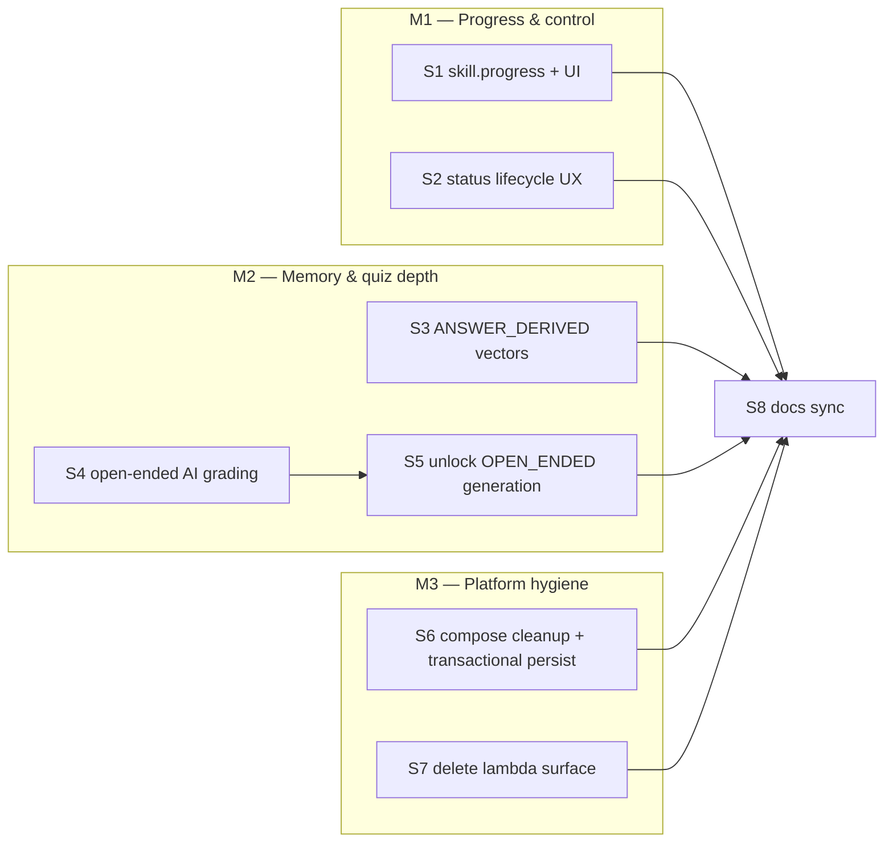

# Axon — Phase 7: Post-beta (progress, memory depth, richer quizzes, platform hygiene)

> Written 2026-09-22 from a verified code audit; re-verified 2026-09-30 through S2 at `7dfb6b7`
> and through M3 in this change (backend suite counts per ARCHITECTURE §8).
> Status: **IN PROGRESS — S1, S2, S6, S7 DONE (2026-09-30); S3–S5 pending** — this file is the execution authority for everything
> after beta. Since 2026-09-22, out-of-plan work landed WITHOUT consuming S1–S7 scope:
> class Q&A / Ask-AI (`6c1efeb`, `e4ea158`, `457b740`), quiz-exit redirect to the lessons
> list (`e988e6e`), 10 s skill-status polling (`7dd5af7`), Source Sans 3 + blue-tinted
> theme (`fc4babc`, `734d264`), prod-image fix (`71a9643`), universal-APK EAS builds
> (`8029e7d`). Background: `BETA_PLAN.md` (beta, DONE), `ARCHITECTURE.md` (current state),
> `GAPS.md` (gap ledger, closed items), `BUSINESS_DECISIONS.md` (decision record).

## 0. Verified current state (2026-09-22)

Beta (Phases 1–6 + Firebase auth) is DONE. Backend suite **108/108 green** (vitest, 19 files
incl. `loop.integration.test.ts`, the next-class worker/sweeper/reconciler tests, and the
class-Q&A tests); mobile `pnpm --filter @axon/mobile exec tsc --noEmit` clean — both
re-verified 2026-09-30 at `48c484b`. The TS 5.9→7.0.2 upgrade is **committed** (`d974bd2`; ts-node dropped;
`@axon/api-contract` build now also emits `.d.ts` via `tsup && tsc --emitDeclarationOnly`).

What actually remains, with evidence:

| # | Gap | Evidence |
|---|---|---|
| 1 | Progress is list-level only; no per-skill breakdown (per-lesson completion, accuracy) | `SkillRepository.listByUser` (`skill.prisma.repo.ts:41-135`) computes `lessonCount` / `completedLessons` / `learnedPoints` / `lastActivityAt`; `SkillList.tsx:52,75-78` renders them. No `skill.progress` route, no per-class view. `SkillProgress` table (`schema.prisma:180-188`) has **zero code references** |
| 2 | PAUSED / COMPLETED / ARCHIVED unreachable | `SKILL_TRANSITIONS` (`learning/domain/skill/skill.ts:33-41`) allows `ACTIVE→{PAUSED,COMPLETED,ARCHIVED}`, `PAUSED→{ACTIVE,COMPLETED,ARCHIVED}`, `COMPLETED→{ARCHIVED}` — but no command/route/UI drives them (`skill.edit` deliberately excludes status) |
| 3 | Answers leave no memory | `VectorSource.ANSWER_DERIVED` + `Vector.answerId` (`schema.prisma:87-91,215-216`) unused; only `AI_INITIAL`/`AI_NEXT` are written; the next-class prompt knows mistakes only from the *latest* quiz, not from history |
| 4 | Open-ended questions impossible end-to-end | Generation enum `["MULTIPLE_CHOICE","TRUE_FALSE"]` (`tutoring/domain/prompts.ts:65`); `scoreAnswer` returns `{isCorrect:false, score:0}` for OPEN_ENDED (`scoring.ts:13-15`) |
| 5 | Init/next-class relational persist is non-transactional | class + questions inserted via separate repo calls; the Phase 6 retry guard makes reruns *safe* but a crash can still strand a class without questions |
| 6 | Dead infra/config | `rabbitmq:3.12-management` service unused (`docker-compose-dev.yaml:78-89`; no amqplib, nothing `depends_on` it). `Skill.lambda Float @default(0.02)` (`schema.prisma:109`) never written (`create-skill.ts:38-42` passes only userId/topic/status) and never read; `config.skillLambdaDecayDefault` (`config.ts:9-11`) unreferenced; `LAMBDA_DECAY_DEFAULT` isn't even in `.env.example` (ARCHITECTURE §7 row is stale) |

Useful facts that shape the design:

- `Answer.score Float?` / `isCorrect Boolean?` are **already nullable** (`schema.prisma:166-167`)
  — deferred grading needs no migration.
- Cross-module dependency direction is established: tutoring use cases depend on learning
  repos and memory ports; **learning never imports tutoring**. Jobs (`modules/jobs/registry.ts`,
  `makeJobHandlers`) are the sanctioned decoupling path.
- Job infra is split: the generic `JobQueuePort` adapter is still fire-and-forget setImmediate
  (`set-immediate-jobs.ts`, init job), but **next-class is durable** — `NextClassJob` Prisma
  table (unique per skill), lease claim + attempt cap + requeue (`next-class-worker.ts`),
  sweeper/reconciler recover stale work. S3/S4 jobs start on the generic path; adopt the
  durable pattern only if they need retries.
- Error mapping (`platform/api/error-mapping.ts:15-37`): `*NotFound`/`NotOwned` → 404,
  `InvalidSkillTransition` → 409, else 500.
- `SkillRepository.findById` returns `userId` (Phase 6 D7) — ownership checks are cheap.

## 1. Milestones & execution order

M1/M2/M3 are independent of each other; inside M2, **S4 must land before S5** (never generate
a question type that cannot be graded). S8 is always last.

## 2. Design decisions

**D1 — Progress = live derived query; `SkillProgress` table stays untouched.** New query
`learning/application/queries/get-skill-progress.ts`, deps `{ skillRepo, classRepo, quizRepo }`,
input `{ skillId, userId }`:
- Ownership via `skillRepo.findById` (`NotOwned` behind 404, existing mapping).
- New `ClassRepository.listBySkill(skillId)` (if `get-class-list` doesn't already expose a
  reusable form) and one aggregation method
  `QuizRepository.findAnswerStatsBySkill(skillId, userId): Array<{ classId, answeredCount, correctCount }>`
  (Prisma `groupBy` through the `Answer → Question` join — same pattern as `listByUser`).
- Output: `{ skillId, topic, status, totals: { lessonCount, completedLessons, learnedPoints,
  accuracy }, classes: [{ classId, index, title, questionCount, answeredCount, correctCount,
  completed, accuracy }] }`. `accuracy = correct / gradedAnswered` (null-correct answers excluded).
- No snapshot writes: the derivation is cheap at beta scale and snapshots have no consumer.
  The table stays (harmless); revisit only if history-of-progress becomes a feature.
*Rejected:* writing `SkillProgress` snapshots on submit — write cost, no reader.

**D2 — One `skill.updateStatus` command; user-settable targets are a whitelist.** Command
`learning/application/commands/set-skill-status.ts`, deps `{ skillRepo }`, input
`{ skillId, userId, status }`. Rules:
- `status` must be in `{ PAUSED, ACTIVE, COMPLETED, ARCHIVED }` — `GENERATING`/`FAILED` are
  machine-managed (retry owns `FAILED`); anything else ⇒ `InvalidSkillTransition` (409).
- `canTransition(current, target)` must hold (reuse the pure state machine).
- Ownership: `findById` + `userId` compare ⇒ `NotOwned` (404).
Contract: `updateStatus` route `POST /skill/:id/status`, input `{ id, status }`, output = existing
`StatusOnly`. `skill.list` gains optional `includeArchived` (default **false**) — archived
skills disappear from the list but stay reachable by deep link (detail shows an "Archived" chip).
- **Pause gates generation**: in `generate-next-class`, right after the skill load:
  `if (skill.status !== "ACTIVE") return ok(...)` (no event, no AI call). A paused skill's
  submits still score and persist — they just never spawn lessons. Mirrors the retake-dedup
  branch shape from Phase 6 D3.

**D3 — Answer memory = background mining job, deduped per answer, wrong answers only.**
- `submit-quiz` (after persisting scored answers): enqueue
  `SKILL_ANSWER_VECTORS_JOB` (`"skill-answer-vectors"`, payload `{ skillId, userId, answerIds }`)
  with the **wrong** MC/TF answer ids (cap 10/submit). The grading job (D4) calls the same
  miner later for wrongly-graded open-ended answers — one code path, two triggers.
- New memory use case `memory/application/mine-answer-vectors.ts`, deps
  `{ vectorMetadata, recordVectors, quizRepo, classRepo }`:
  - Dedup first: new `VectorMetadataRepository.findAnswerIdsWithVectors(answerIds)` — an
    answer is mined at most once ever (retakes re-enqueue; dedup makes it idempotent).
  - Snippet per wrong answer (atomic third-person learner fact, same voice as `AI_INITIAL`):
    `Struggled with: <question text>. Answered "<user answer>"; correct: "<answerKey>" (<class title>).`
  - `recordVectors` with `source: ANSWER_DERIVED`, `skillId`, `classId`, `classIndex`, and —
    new optional per-item field — `answerId` (the `Vector.answerId` column finally gets a writer).
- Prompt: `buildNextClassPrompt` gains a third history block filtered on
  `source === "ANSWER_DERIVED"`: *"Known gaps — the learner has missed these before; weave in
  a re-test."* `AI_NEXT`/`AI_INITIAL` blocks unchanged; retrieval `topK` stays 12 across the
  now three sources.
*Rejected:* mining inside the next-class use case — vectors would only exist when a lesson is
generated, and dedup would fight the retake flow.

**D4 — Open-ended grading = background job; submit stays fast; nullability carries "pending".**
- `submit-quiz`: OPEN_ENDED answers persist with `score: null, isCorrect: null` (schema already
  nullable); when ≥1 open-ended answer exists, enqueue `GRADE_OPEN_ENDED_JOB`
  (`"grade-open-ended"`, payload `{ answerIds }`).
- New tutoring use case `tutoring/application/grade-open-ended.ts`, deps
  `{ ai, quizRepo }` (extend the repo submit-quiz uses with `findAnswersWithQuestions(answerIds)`
  and `updateGrades(rows)`):
  - One batched `ai.generateJson` call per submit batch. New persona `GRADER_SYSTEM`
    (`tutoring/domain/personas.ts`): fair strict grader, judges the submitted answer against the
    model answer, 1–2 sentence actionable feedback.
  - New `GRADING_SCHEMA`: `{ results: [{ answerId: number, score: 0..1, correct: boolean,
    feedback: string }] }`.
  - Persist: `Answer.score/correct` updated; feedback merged into `Answer.content` JSON
    (`{ answer, feedback }` — Json column, no migration; shape documented here).
  - **Degrade, never hang**: parse failure or AI error ⇒ every answer in the batch scores 0 /
    incorrect with feedback "Grading failed — resubmit to re-grade" (mirrors the retrieval
    degrade policy and `scoring.ts`'s current 0-score default). No retry in beta.
- Contract (`SubmitQuizAnswersOutput.perQuestion`): each item gains `type: QuestionType`;
  `isCorrect` becomes `boolean | null` (null ⇒ pending grading); `correctAnswer` stays `null`
  for OPEN_ENDED forever — the model answer never leaves the server.
- Mobile `QuizResult`: open-ended rows render a "Grading…" chip when `isCorrect === null`;
  the class/quiz queries invalidate on screen focus so returning to the lesson shows graded
  scores. `listByUser` aggregations treat `isCorrect: null` as *answered but ungraded*
  (`correctCount` filters `isCorrect: { not: null }`; completion counts attempts).
*Rejected:* synchronous grading in submit (AI latency on the request path; would also make
learning import tutoring, breaking the established dependency direction).

**D5 — Unlock OPEN_ENDED generation only after grading is live (S4 → S5).**
`INIT_SKILL_SCHEMA.questions.items`: `type.enum += "OPEN_ENDED"`; keep `choices`/`answerKey`
required unconditionally (open-ended: `choices: []`, `answerKey` = the model answer) — no
JSON-schema conditionals (glm drift is already handled by per-field re-validation in
`tutoring/domain/parse.ts`; extend its normalizer: OPEN_ENDED ⇒ force `choices: []`).
`lessonJsonInstructions` gains: "Include 1–2 open-ended questions per lesson (type
OPEN_ENDED, choices: [], answerKey: a model answer)." `quiz.get` already strips `answerKey`.
Mobile `Quiz.tsx` already renders an open-ended input — no quiz-render change needed.

**D6 — Delete the unused RabbitMQ container; transactional relational persist; broker stays a seam.**
- Remove the `rabbitmq` service + `rabbitmq_data` volume from `docker-compose-dev.yaml`
  (nothing references it; ROADMAP's principle "don't let the queue be a bootstrap risk" still
  holds). Durable execution already exists for next-class (`NextClassJob` + sweeper);
  S3/S4 jobs start on the generic setImmediate path and adopt that pattern only if retries
  matter. Broker adoption stays deferred — the adapter seam is the architecture, the broker
  is not.
- New `ClassRepository.createWithQuestions(class, questions)` (single Prisma `$transaction`):
  used by **both** `generate-initial-skill` and `generate-next-class`, replacing the separate
  class-create + questions-insert calls. Vectors stay best-effort after the relational commit
  (Qdrant can't join a PG transaction; the existing degrade policy covers a vector failure).
*Rejected:* adopting RabbitMQ now — no durability requirement at single-user scale; deleting
dead infra closes GAPS 10 honestly.

**D7 — Delete the lambda surface instead of "tuning" it.** ROADMAP explicitly deferred lambda
decay "until real usage data" — an unread knob is worse than no knob. Delete: `Skill.lambda`
column (Prisma migration, `DROP COLUMN`), `config.skillLambdaDecayDefault`, `lambda` from
`SkillListItem` + `listByUser` select, and the stale `LAMBDA_DECAY_DEFAULT` row in
ARCHITECTURE §7. If `lambda` appears in the `skill.list` wire schema, remove it there too
(mobile types update automatically through the rpc client). Re-add when a real decay design
exists with data to fit it against.

## 3. Implementation steps

### S1 — ✅ DONE (2026-09-30) — `skill.progress` route + progress UI (D1)
- Backend: `get-skill-progress.ts` + repo methods (`listBySkill` if needed,
  `findAnswerStatsBySkill`); contract `progress` entry (`SkillIdInput` → new
  `SkillProgressOutput` schema in `schema/skill.schema.ts`); handler + router wiring
  (`SkillApiDeps` gains the query — same pattern as `retry`).
- Tests: `get-skill-progress.test.ts` — empty skill, partially-answered class, completed
  class, pending-open-ended exclusion from accuracy, NotOwned.
- Mobile: progress section on the skill detail screen (`app/skill/[skillId].tsx` /
  `components/skill/`): per-lesson bars "answered/total", accuracy %, "resume at lesson N"
  (first class with `completed === false`). List rows keep the existing counters.

### S2 — ✅ DONE (2026-09-30) — Status lifecycle UX (D2)
- Backend: `set-skill-status.ts` + tests (each happy transition, non-whitelisted target,
  invalid transition from current state, NotOwned); contract `updateStatus`;
  `skill.list` `includeArchived` (schema default false, `listByUser` filter); next-class
  pause guard + cases in `generate-next-class.test.ts`.
- Mobile: detail-screen menu — Pause/Resume, Mark completed, Archive (`useMutation` →
  invalidate skills query); status chip on detail; the FAILED/retry flow is untouched.

### S3 — `ANSWER_DERIVED` answer memory (D3)
- `mine-answer-vectors.ts` + `findAnswerIdsWithVectors` + `recordVectors` per-item `answerId`
  + registry entry `skill-answer-vectors` + submit-quiz enqueue (wrong MC/TF ids, cap 10).
- `buildNextClassPrompt` third block; `parse.ts` untouched (sources are labels, not schema).
- Tests: miner (wrong-only, dedup per answerId, cap, embed-failure degrade = ok with nothing
  recorded), prompt block rendering, and extend `loop.integration.test.ts`: after the wrong
  submit, run the new handler → vector with `ANSWER_DERIVED` + `answerId` recorded; next
  prompt contains the gap line.

### S4 — Open-ended AI grading (D4)
- `grade-open-ended.ts` + `GRADER_SYSTEM` + `GRADING_SCHEMA`; repo
  `findAnswersWithQuestions` / `updateGrades`; registry entry `grade-open-ended`; submit-quiz
  null-score persist + enqueue; contract `perQuestion` gains `type` + nullable `isCorrect`
  (contract rebuild: `pnpm --filter @axon/api-contract build`).
- Tests: grader (batch happy path, parse-failure degrade, feedback persisted into content
  JSON), submit (open-ended → null score + enqueue), integration: submit with open-ended →
  run grade handler → `Answer.score` set, prompt feedback path unaffected.
- Mobile: `QuizResult` pending chip + focus invalidations.

### S5 — Unlock OPEN_ENDED generation (D5) — after S4
- `INIT_SKILL_SCHEMA` enum + `lessonJsonInstructions` line; `parse.ts` normalizer
  (OPEN_ENDED ⇒ `choices: []`); prompt-structure tests updated.

### S6 — ✅ DONE (2026-09-30) — Compose cleanup + transactional persist (D6)
- Delete `rabbitmq` service + volume from `docker-compose-dev.yaml`.
- `createWithQuestions` transaction; rewire init + next-class; their existing tests assert
  the composite call (fakes updated).
- Verified 2026-09-30: `docker compose -f docker-compose-dev.yaml config -q` passes (YAML
  validity without daemon pulls). Live up → `/health` 200 smoke skipped: the Tailscale exit
  node blocks image pulls (`EAI_AGAIN`), and the standing constraint is to leave Tailscale
  alone.

### S7 — ✅ DONE (2026-09-30) — Delete lambda surface (D7)
- Migration dropping `Skill.lambda`; remove from schema, `SkillListItem`, `listByUser`
  select, `config.ts`; sweep test fixtures; contract list schema if it exposes `lambda`;
  fix the stale ARCHITECTURE §7 row.

### S8 — Docs sync (always last)
- ARCHITECTURE.md (RPC table: `skill.progress`, `skill.updateStatus`; §4.2 answer-memory +
  grading flow; §5 enums; §7 env; §8 test inventory; §9 backlog shrinks to what remains),
  GAPS.md (8 closed by S1, 10 closed by S6+S7, 13 closed by S6), BETA_PLAN.md status line,
  this file's steps checked off.

## 4. Testing & verification

- Every step follows existing conventions: curried use cases, fake ports, `Result`
  assertions, colocated `*.test.ts`.
- Full gates per step: `pnpm --filter @axon/backend test` (vitest) and
  `pnpm --filter @axon/mobile exec tsc --noEmit`. Contract-touching steps (S1, S2, S4, maybe
  S7): `pnpm --filter @axon/api-contract build` first — the backend resolves `dist/`.
- Emulator visual checks (S1 progress view, S2 status menu, S4 grading chip): one pass at
  the end of M1 and M2 respectively.
- Integration test stays the composed-loop guardrail; S3/S4 extend its scenario rather than
  adding a parallel harness.

## 5. Phase acceptance (done when)

1. Skill detail shows per-lesson progress (answered/total per class) + accuracy from
   `skill.progress`; a fresh skill shows zeros, not an error.
2. A user can pause → submit → verify **no** new lesson appears; resume → next submit
   generates; complete and archive work; archived skills vanish from the list but open by
   deep link.
3. Answering wrong persists an `ANSWER_DERIVED` vector keyed by `answerId` exactly once per
   answer, and the next generated lesson's prompt contains the "Known gaps" block
   (integration-test asserted).
4. A generated lesson can contain open-ended questions; submitting shows "Grading…" and the
   graded score + feedback appear without a rebuild; a grading failure degrades to 0 with
   feedback instead of hanging or throwing.
5. Dev compose has no rabbitmq; a crash between class-create and question-insert is
   impossible (single transaction).
6. `lambda` is gone from schema, config, wire, and docs; the full suite (≥ existing 64
   tests + all new cases) is green; docs match code.

## 6. Explicitly out of scope (still)

Multi-user scaling/billing, web admin, durable job broker adoption (seam only),
`SkillProgress` snapshots, spaced-repetition scheduling, user-generated content, lambda decay
**reintroduction** (needs real usage data first).
